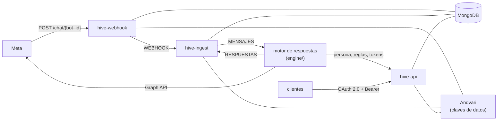

# Hive

**La plataforma para la gestión automatizada de tus bots y agentes.**

Hive atiende a las personas que escriben a tus bots por WhatsApp y Messenger; Instagram ya está en el contrato, pero
el webhook todavía no lo lee. Las recibe, decide con un
modelo propio si cada mensaje se atiende, responde con la persona y las reglas de cada bot, y lo deja todo en el
historial. Es multi-cliente: cada cliente gestiona sus bots con su propia clave, y sus datos van cifrados con la suya.

- **API de gestión:** `https://hive-api.higerotech.com`
- **Su documentación:** `https://hive.higerotech.com/docs` ([ADR-0026](docs/00-project/adr/0026-documentacion-publica-de-la-api.md))
- **Webhook de Meta:** `https://hive-webhook.higerotech.com/chat/{bot_id}`

Este repositorio, `jeremialcala/hive`, guarda sus dos partes ([ADR-0024](docs/00-project/adr/0024-el-producto-se-llama-hive.md)):

| Parte | Dónde | Imagen | Contenedores |
|---|---|---|---|
| El gateway: webhook, API de gestión e ingesta | la raíz | `ghcr.io/jeremialcala/hive-gateway` | `hive-webhook`, `hive-api`, `hive-ingest` |
| El motor de respuestas: clasificador, coordinador, de respuesta y notificador | [`engine/`](engine/) | `ghcr.io/jeremialcala/hive-engine` | `hive-classifier`, `hive-coordinator`, `hive-responder`, `hive-notifier` |

Hasta el 2026-10-22 el repositorio se llamó `wh-python-fastapi-messenger`; GitHub redirige el nombre viejo.

## El gateway

La puerta de Hive con Meta y con los clientes, construida con FastAPI. Son tres servicios de la misma imagen:

- **El webhook** recibe lo que Meta envía de los chatbots de WhatsApp y Messenger, comprueba la firma y lo publica en Bifröst, el bus de eventos ([ADR-0021](docs/00-project/adr/0021-el-webhook-solo-publica.md)).
- **El worker de ingesta** identifica a cada contacto, guarda el historial y pasa cada mensaje al motor de respuestas. También guarda en el historial lo que el motor envió.
- **La API de gestión** es por donde cada cliente da de alta y configura sus chatbots, y por donde el motor lee lo que necesita de ellos: la persona, las reglas, las herramientas y los tokens de Meta.

El cifrado del sobre como JWE y el registro de cada petición como **evento** con sus **acciones** están implementados, pero hoy están desactivados en el código.

---

## Índice

- [Visión de la arquitectura](#visión-de-la-arquitectura)
- [Tecnologías](#tecnologías)
- [Estructura del proyecto](#estructura-del-proyecto)
- [Ciclo de vida de una petición](#ciclo-de-vida-de-una-petición)
- [Endpoints de la API](#endpoints-de-la-api)
- [Modelo de datos (colecciones de MongoDB)](#modelo-de-datos-colecciones-de-mongodb)
- [Registro de eventos y criptografía](#registro-de-eventos-y-criptografía)
- [Configuración](#configuración)
- [Ejecución en local](#ejecución-en-local)
- [Ejecución con Docker](#ejecución-con-docker)
- [Despliegue](#despliegue)
- [Logging](#logging)
- [Seguridad](#seguridad)
- [Licencia](#licencia)

---

## Visión de la arquitectura



- **Webhook de entrada**: Meta envía el reto de verificación (`GET`) y las notificaciones (`POST`) a `/chat/{bot_id}`. El webhook busca el bot y su App Secret, comprueba la firma y responde a Meta en cuanto Bifröst confirma la publicación. No toca el historial.
- **Ingesta**: `hive-ingest` lee el stream `WEBHOOK`. Salta lo que ya está en el historial, busca o crea a cada remitente como `Contact` (los de Messenger, con su perfil de la API Graph), publica el mensaje en `MENSAJES`, en la partición de su conversación, y después lo guarda en el historial. El contrato es [`docs/02-design/contracts/asyncapi-v2.yaml`](docs/02-design/contracts/asyncapi-v2.yaml).
- **Respuestas**: lo que el notificador del motor envía a Meta vuelve por `RESPUESTAS`, y la ingesta lo guarda en el historial.
- **Cola heredada**: la ingesta también publica cada mensaje, en el sobre de la versión 1, en la cola `llm` de Hermod, el RabbitMQ de midgard ([`asyncapi.yaml`](docs/02-design/contracts/asyncapi.yaml)). Desaparece cuando se retire Hermod.
- **Registro de eventos**: una petición puede generar un `Event` y varias `EventAction` con el método, el paso, el estado y el tiempo transcurrido.

---

## Tecnologías

| Ámbito | Tecnología |
|---|---|
| Framework web | [FastAPI](https://fastapi.tiangolo.com/) + Starlette |
| Servidor ASGI | Uvicorn (workers según `WEB_CONCURRENCY`) |
| Base de datos | MongoDB con el ODM [mongoengine](https://mongoengine.org/) (+ `pymongo`, `dnspython`) |
| Validación y ajustes | Pydantic v2, `pydantic-settings` |
| Mensajería | NATS JetStream (Bifröst) con [`nats-py`](https://github.com/nats-io/nats.py) ([ADR-0019](docs/00-project/adr/0019-nats-jetstream-como-bus.md)); RabbitMQ con [`pika`](https://pika.readthedocs.io/), solo para la cola heredada `llm` |
| Criptografía y tokens | `jwcrypto` (JWK/JWE/JWT) y `cryptography` (AES-256-GCM de los campos cifrados) |
| Servicio de claves | Andvari, el OpenBao de midgard, por su API HTTP con `requests` |
| Cliente HTTP | `requests` |
| Trazas | OpenTelemetry (SDK y exportador OTLP/HTTP), sin paquetes de instrumentación |
| Logging | `logging.config` configurado con `PyYAML` |
| Otros | `faker` (valores de ejemplo de los modelos de petición) |
| Pruebas | `pytest`, `pytest-cov`, `jsonschema` |

Las dependencias se declaran en [requirements.txt](requirements.txt) y se fijan con hashes en [requirements.lock](requirements.lock); las de pruebas, en `requirements-dev.txt` y su lock.

---

## Estructura del proyecto

Es un monorepo ([ADR-0023](docs/00-project/adr/0023-monorepo-del-gateway-y-el-motor.md)): el gateway en la raíz y el
motor de respuestas en `engine/`, cada uno con sus dependencias, sus pruebas, su imagen y su CHANGELOG. El motor tiene
su propio [README](engine/README.md).

```
.
├── engine/                 # El motor de respuestas: su código, pruebas, docs y Dockerfile (ADR-0023)
├── shared/                 # Lo que usan el gateway y el motor: contrato v2, bus, trazas, tokens, claves, destinos
├── src/                    # El gateway (con shared/, es lo que contiene la imagen)
│   ├── service.py              # Lo común a los servicios: ajustes, middleware, límites, errores, /health
│   ├── app.py                  # La API de gestión: autenticación y sus rutas
│   ├── webhook.py              # El webhook de Meta: verificación y notificaciones
│   ├── ingest.py               # El worker de ingesta: lee WEBHOOK y RESPUESTAS de Bifröst
│   ├── logging_config.yaml     # Configuración de logging por entorno
│   ├── classes/                # DTO de Pydantic + entidades de mongoengine
│   │   ├── tool_settings.py        # Settings (lee config.env)
│   │   ├── entity_*.py             # Documentos de MongoDB (Client, ChatBot, Contact, ConversationMessage, ...)
│   │   └── dto_*.py                # Modelos de petición/respuesta y del payload de Facebook
│   ├── controller/             # Capa de lógica de negocio
│   │   ├── chatbot.py              # Bots, teléfonos y reglas
│   │   ├── credentials.py          # Credenciales de Meta de un bot
│   │   ├── clients.py              # Registro de clientes y de sus claves
│   │   ├── contacts.py             # Listar, buscar, exportar y borrar contactos
│   │   ├── intents.py              # CRUD de intents y su esquema de herramientas
│   │   ├── incoming.py             # Lectura de una notificación de Meta
│   │   ├── webhook_event.py        # El evento que el webhook publica en WEBHOOK
│   │   ├── ingestion.py            # La ingesta de cada mensaje y de cada respuesta
│   │   ├── erasure_notices.py      # Los avisos de borrado al motor (SUPRESIONES)
│   │   ├── facebook.py             # Identificación de contactos + perfiles de la API Graph
│   │   ├── messages.py             # Procesado de mensajes entrantes
│   │   ├── events.py               # Registro de Event / EventAction
│   │   └── amqp_broker.py          # Publicador de RabbitMQ (cola heredada)
│   ├── auth/                   # Tokens de acceso, quién llama y qué claves públicas se aceptan
│   ├── crypto/                 # Cifrado de los datos de cada cliente
│   ├── repository/             # La única vía a los datos de un cliente
│   ├── ops/                    # Comandos del operador y cliente de referencia
│   ├── migrations/             # Pasos de datos que se ejecutan a mano
│   ├── constants/              # Cadenas estáticas: metadatos de la doc, cabeceras, claves de FB, formatos
│   ├── enums/                  # Status, Environment, KeyTypes, Role y Worker
│   └── utils/                  # Logging, límite de cuerpo, generadores de códigos, verificación de firma, claves JWK/PEM
│
├── tests/                  # Pirámide de pruebas: unit/ integration/ contract/ e2e/ security/ (ver tests/README.md)
├── docs/                   # Documentación AI-DLC, una carpeta por fase (00-project ... 06-monitoring)
├── .ai-dlc/                # Checklists de los gates, plantillas, mapeo OWASP y scripts (contrato OpenAPI)
├── deploy/                 # El compose del servidor, la página de documentación (docs/) y el vigía (vigia/)
├── assets/                 # El design system exportado (design-system/) y el logotipo (logos/) — ADR-0027
├── .github/                # Workflows (ci, build, engine, build-engine, seguridad, guardia GitFlow) y CODEOWNERS
│
├── Dockerfile              # Imagen python:3.12-slim, usuario sin privilegios, uvicorn en :5002
├── .dockerignore           # Deja config.env, certs/ y los ficheros de desarrollo fuera del contexto de build
├── requirements.txt        # Dependencias de ejecución, como rangos; requirements-dev.txt añade las de pruebas
├── requirements.lock       # Las mismas, fijadas con hashes; requirements-dev.lock para las pruebas
├── pytest.ini              # Añade src/ al path: `pytest` se ejecuta desde la raíz
├── config.env.example      # Plantilla de config.env (ignorado por git, lo carga pydantic-settings)
├── CHANGELOG.md  SECURITY.md  CONTRIBUTING.md
├── bootstrap.sh            # Heredado: clona, reconstruye y arranca. Borra TODOS los datos de Docker sin usar del host
├── compose-dev.yaml        # Ayuda de "Dev Environments" de Docker (no es el runtime de la app)
├── certs/                  # Claves privadas RSA por evento (*.pem), ignoradas por git
└── prototypes/             # Experimentos desechables (ignorados en .gitignore)
```

Cada parte sigue la estructura AI-DLC ([ADR-0001](docs/00-project/adr/0001-adopcion-estructura-ai-dlc.md)).

### Responsabilidad de cada paquete

- **`classes/`** — única superficie de importación (`from classes import ...`). Mezcla dos papeles:
  - **Entidades** (`entity_*.py`): subclases de `mongoengine.Document`. Cada módulo abre su propia conexión a MongoDB al importarse, con los valores de `Settings`.
  - **DTO** (`dto_*.py`): modelos de Pydantic para los cuerpos de petición, las respuestas y el payload anidado del webhook de Facebook/WhatsApp (`dto_facebook_*.py`).
- **`controller/`** — funciones asíncronas con prefijo `ctr_*`, reexportadas desde `controller/__init__.py`. Construyen un `ResponseData`, persisten datos, emiten acciones de evento y devuelven un `starlette.Response`.
- **`crypto/`** — el cifrado de los datos de cada cliente: los campos y el índice ciego (`fields.py`) y el cliente del servicio de claves (`key_service.py`).
- **`auth/`** — la autenticación de la API de gestión ([ADR-0025](docs/00-project/adr/0025-oauth2-client-credentials-con-private-key-jwt.md)): los tokens de acceso que emite `/oauth/token` (`access_tokens.py`), quién llama y qué alcanza (`principal.py`) y qué clave pública se le acepta a un cliente (`client_keys.py`). Lo que comparte con el motor está en `shared/auth/`: la aserción del cliente (`tokens.py`), las claves del gateway (`gateway_keys.py`), la prueba de una clave nueva (`key_proof.py`) y el lado del cliente (`client.py`).
- **`ops/`** — comandos que se ejecutan a mano: `gateway_key` crea y rota las claves del gateway, `operator_key` registra la primera clave del operador, `engine_keys` da de alta las claves del motor para un cliente y `client` es el cliente de referencia.
- **`repository/`** — la única vía a los datos de un cliente. `TenantRepository` se construye con el cliente y lo añade a cada consulta: lo ajeno responde igual que lo inexistente ([ADR-0012](docs/00-project/adr/0012-aislamiento-por-cliente-en-la-capa-de-datos.md)). Los controladores no consultan la base.
- **`migrations/`** — pasos de datos que se ejecutan a mano:
  - `assign_operator_client` asigna al cliente del operador los documentos anteriores a la existencia de clientes. `python -m migrations.assign_operator_client` informa y `--apply` escribe.
  - `encrypt_client_data` cifra lo que se guardó en claro antes de que cada cliente tuviera su clave de datos.
  - `replay_erasures` rehace los borrados del registro de supresiones tras restaurar un respaldo ([ADR-0014](docs/00-project/adr/0014-supresion-en-respaldos-por-caducidad.md)).
- **`constants/`** — `documentation.py` alimenta los metadatos de OpenAPI; `facebook.py` contiene las claves de verificación `hub.*`; `headers.py` y `formats.py`, los nombres de cabecera y los tipos de contenido.
- **`enums/`** — `Status` (REG/ACT/LOK/DIS/OVR/ERR/COM), `Environment` (development/staging/production), `KeyTypes`, `Role` (cliente, operador, servicio) y `Worker`, los workers del motor, que viene de `shared/workers.py`.
- **`utils/`** — `configure_logging()` (se ejecuta al arrancar), el límite de tamaño del cuerpo, `generate_code()`, la verificación de firmas y las ayudas de JWK/PEM (`get_private_key`, `get_public_key`).

---

## Ciclo de vida de una petición

Lo común a los dos servicios HTTP está en [src/service.py](src/service.py):

1. **El límite de cuerpo** rechaza con `413` lo que pasa de 3 MiB, antes de comprobar firma o token.
2. **El middleware HTTP `interceptor`** se ejecuta en cada petición:
   - Abre un span de la traza (no en `/health`), anota la hora de inicio y añade `X-Processing-Time` a la respuesta.
   - Envuelve `call_next` en try/except/finally, de modo que ante un fallo siempre se devuelve un `ResponseData` con `500`.
   - Deja una línea de log por petición, con la ruta declarada y el código de respuesta.
   - `request.state.event_id` vale `None`: el registro de eventos está desactivado.
3. **Las dependencias** autentican la petición antes de que corra ningún handler: el token de acceso en la API de gestión, y `X-Hub-Signature-256` en las notificaciones del webhook (ver [Seguridad](#seguridad)). Las rutas de un cliente reciben su repositorio; las del registro exigen además que sea el operador, y las del motor, que sea el worker que toca.
4. **Los handlers de ruta** llaman al controlador `ctr_*` que corresponde y devuelven su `Response`.
5. **Los controladores** persisten con mongoengine a través del repositorio del cliente. En el webhook, la notificación se publica en Bifröst y Meta recibe su `200` cuando el bus la confirma; el resto lo hace después `hive-ingest`.

---

## Endpoints de la API

URL base en local: `http://localhost:5002` para la API de gestión y `http://localhost:5003` para el webhook, que son dos servicios ([ADR-0018](docs/00-project/adr/0018-webhook-y-gestion-por-separado.md)).
La documentación pública de la API de gestión está en `https://hive.higerotech.com/docs`, generada con el contrato [`openapi.yaml`](docs/02-design/contracts/openapi.yaml). La interactiva, `/docs` (Swagger) y `/redoc`, solo se sirve en `development`.

Sin token solo se llaman las dos rutas del webhook (`GET` y `POST /chat/{bot_id}`), `POST /oauth/token` y `GET /health`. Cualquier otro endpoint exige un token de acceso en `Authorization: Bearer` y responde `401` sin uno válido. El token se pide a `/oauth/token` con una aserción firmada por la clave del cliente (OAuth 2.0 `client_credentials` con `private_key_jwt`, [ADR-0025](docs/00-project/adr/0025-oauth2-client-credentials-con-private-key-jwt.md)). Cómo se construye, y cómo se da de alta a un cliente, está en [docs/03-implementation/autenticacion.md](docs/03-implementation/autenticacion.md).

### OAuth — etiqueta `OAuth`

| Método | Ruta | Descripción |
|---|---|---|
| `POST` | `/oauth/token` | Cambia una aserción del cliente por un token de acceso. Cuerpo `application/x-www-form-urlencoded`: `grant_type=client_credentials`, `client_assertion_type` y `client_assertion` (un JWT ES256 del cliente, de 60 segundos como máximo y de un solo uso, dentro de un JWE para una clave de `GET /gateway/keys`). Devuelve un token `Bearer` que el gateway firma y que vale 10 minutos. `401 invalid_client` si la aserción no vale, sin decir por qué. |

### Gestión de bots — etiqueta `Bot`

| Método | Ruta | Cuerpo | Descripción |
|---|---|---|---|
| `POST` | `/bot` | `ChatbotRequest` | Crea un chatbot del cliente que llama. Genera un `uuid` y un `verifyToken` firmado (JWT). Devuelve `BotResponse`. |
| `DELETE` | `/bot/{bot_id}` | — | Borra un chatbot con todo lo guardado para él: contactos, números, reglas e intents. No se puede deshacer. Desde entonces su webhook responde `404`: también hay que quitar la suscripción en Meta. |

Campos de `ChatbotRequest`: `name`, `role`, `description`, `tone`. Hay que enviarlos todos: el modelo todavía tiene valores de ejemplo, y el que falta se rellena con uno.

Dar de alta un bot, de punta a punta:

1. `POST /bot` → el `uuid` del bot y su `verifyToken`.
2. `PUT /chat/{bot_id}/credentials` con los tokens de Meta y el `appSecret` de la app.
3. `POST /chat/{bot_id}/rules`, y si hace falta `POST /chat/{bot_id}/intents`.
4. En la app de Meta, la URL de callback `https://hive-webhook.higerotech.com/chat/{bot_id}` con el `verifyToken`, suscrita a `messages`.

El motor solo atiende los bots de un cliente para el que el operador dio de alta sus claves (ver [Dar paso al motor de respuestas](docs/03-implementation/autenticacion.md#dar-paso-al-motor-de-respuestas)).

### Chat y webhook — etiqueta `Chat`

| Método | Ruta | Descripción |
|---|---|---|
| `GET`  | `/chat/{bot_id}` | **Verificación del webhook de Meta.** Valida `hub.mode=subscribe` y compara `hub.verify_token` con el `verifyToken` del bot; después devuelve `hub.challenge` como texto plano. Cualquier otra cosa es un `403`. |
| `POST` | `/chat/{bot_id}` | **Mensajes entrantes.** Exige un `X-Hub-Signature-256` válido (`403` si no). Recibe un `FacebookRequest` de Messenger (`object=page`) o de WhatsApp (`object=whatsapp_business_account`). Publica en `WEBHOOK` un evento por notificación con todos sus mensajes; los acuses de entrega y de lectura, los ecos de lo que envía la página y las pulsaciones de botones se aceptan y no se publican. Responde `200` cuando Bifröst ha confirmado la publicación, y también a lo firmado que no entiende o no puede procesar, que deja en el log. Responde `503`, para que Meta reintente, solo si no están el bus, la base de datos o el servicio de claves. |
| `POST` | `/chat/{bot_id}/phones` | Registra un número de WhatsApp (`ChatbotPhoneRequest`: `environment`, `phoneNumber`, `phoneId`). |
| `GET`  | `/chat/{bot_id}/phones?environment=` | Lista los números del bot; con `environment` devuelve el más reciente de ese entorno. |
| `GET`  | `/chat/{bot_id}/info` | Devuelve la información guardada del bot (`chatbot_info()`) y su token de verificación. De las credenciales de Meta solo dice cuáles están cargadas. |
| `PUT`  | `/chat/{bot_id}/credentials` | Carga o rota las credenciales de Meta del bot (`BotCredentialsRequest`: `facebookToken`, `whatsappToken`, `appSecret`). No las devuelve. |
| `GET`  | `/chat/{bot_id}/tokens` | Los tokens de Meta del bot, **solo para el notificador del motor de respuestas**, con la clave que tiene para el cliente dueño del bot. Cada entrega queda en el log. |
| `GET`  | `/chat/{bot_id}/rules` | La persona del bot y sus reglas, como datos (`name`, `role`, `tone`, `description`, `rules`): el motor escribe con ellos el `system` del modelo. |
| `POST` | `/chat/{bot_id}/rules` | Añade una o varias reglas al bot (`RulesRequest.rules: list[str]`). |

### Contactos — etiqueta `Contacts`

| Método | Ruta | Descripción |
|---|---|---|
| `GET`  | `/chat/{bot_id}/contacts?offset=&limit=` | Lista los contactos del bot, por páginas, con todo lo guardado de cada uno. |
| `POST` | `/contacts/search` | Encuentra a una persona en todos los bots del cliente (`ContactSearchRequest`: `waId` o `fbId`). |
| `GET`  | `/chat/{bot_id}/contacts/{contact_id}` | Exporta lo guardado de un contacto. |
| `DELETE` | `/chat/{bot_id}/contacts/{contact_id}` | Borra un contacto. No se puede deshacer. |
| `GET`  | `/chat/{bot_id}/contacts/{contact_id}/turns` | Las últimas 10 vueltas de una conversación, **solo para el coordinador del motor**. Cada entrega queda en el log. |

Cómo se atiende con ellos a quien pide sus datos, y qué no alcanza el borrado, está en
[docs/03-implementation/exportar-y-borrar.md](docs/03-implementation/exportar-y-borrar.md).

### Intents — etiqueta `Intents`

| Método | Ruta | Descripción |
|---|---|---|
| `POST` | `/chat/{bot_id}/intents` | Crea un intent para el bot (`IntentRequest`). |
| `GET`  | `/chat/{bot_id}/intents` | Lista los intents del bot. |
| `GET`  | `/chat/{bot_id}/intents/{intent_id}` | Devuelve un intent. |
| `PUT`  | `/chat/{bot_id}/intents/{intent_id}` | Actualiza un intent. |
| `DELETE` | `/chat/{bot_id}/intents/{intent_id}` | Borra un intent. |
| `GET`  | `/chat/{bot_id}/tools` | Devuelve las acciones activas de los intents activos del bot como una lista plana de definiciones de herramientas para el LLM. |

### Clientes y claves — etiqueta `Clients`

| Método | Ruta | Quién | Descripción |
|---|---|---|---|
| `GET` | `/gateway/keys` | cualquiera con token | La audiencia y las claves públicas del gateway a las que se cifran las aserciones. Se vuelve a pedir cuando el gateway rota la suya. |
| `GET` | `/keys` | el cliente | Sus claves registradas. |
| `POST` | `/keys` | el cliente | Registra una segunda clave pública para rotar. La clave nueva firma una prueba ligada al token de la misma petición. |
| `DELETE` | `/keys/{kid}` | el cliente | Revoca una de sus claves. La última no se puede quitar. |
| `POST` | `/clients` | el operador | Registra un cliente con su primera clave pública (`ClientRequest`: `name`, `signingKey`). Devuelve su `uuid`, la audiencia y las claves del gateway. |
| `GET` | `/clients` | el operador | Lista los clientes y sus claves. |
| `DELETE` | `/clients/{client_id}` | el operador | Da de baja a un cliente: sus claves dejan de valer y se borran sus chatbots, con todo lo suyo, y su clave de datos. No se puede deshacer. |
| `POST` | `/clients/{client_id}/keys` | el operador | Registra otra clave para un cliente que perdió la suya. |
| `DELETE` | `/clients/{client_id}/keys/{kid}` | el operador | Revoca una clave de un cliente. |
| `POST` | `/clients/{client_id}/service-keys` | el operador | Registra la clave de un worker del motor para ese cliente (`signingKey`, `worker`). Dos como mucho por worker y cliente. |
| `DELETE` | `/clients/{client_id}/service-keys/{kid}` | el operador | Quita una clave del motor para ese cliente. |

### Salud — etiqueta `Health`

| Método | Ruta | Descripción |
|---|---|---|
| `GET` | `/health` | Sonda de vida. Responde sin tocar MongoDB ni RabbitMQ. |

---

## Modelo de datos (colecciones de MongoDB)

Todas las entidades son `Document` de mongoengine y se conectan a la base configurada en `config.env`. Lo que es de un cliente lleva su `clientId`, y el repositorio lo añade a cada consulta.

| Entidad | Fichero | Campos clave | Propósito |
|---|---|---|---|
| `Client` | `entity_client.py` | `uuid`, `name`, `role`, `signingKeys`, `serviceKeys`, `wrappedDataKey`, `status` | Un cliente de Hive: sus claves públicas, las de los workers del motor que lo atienden y su clave de datos, envuelta por Andvari. |
| `ChatBot` | `entity_chatbot.py` | `uuid`, `clientId`, `name`, `role`, `description`, `tone`, `verifyToken`, `facebookToken`, `whatsappToken`, `appSecret`, `status` | Un chatbot. Los tokens, el App Secret y el `verifyToken` se guardan cifrados. `generate_verification_token()` emite el JWT firmado que se usa para verificar el webhook ante Meta. |
| `ChatbotPhone` | `entity_chatbot_phones.py` | `uuid`, `clientId`, `bot_id`, `environment`, `phoneNumber`, `phoneId` | Números de WhatsApp asociados a un bot, separados por entorno. El número va cifrado. |
| `Contact` | `entity_contact.py` | `_uuid`, `clientId`, `botId`, `firstName`, `lastName`, `profilePic`, `fbId`, `waId`, `waIdIndex` | Una persona que escribe a un bot. Se busca por `fbId` o por el índice ciego de su número (`waIdIndex`); los contactos de Messenger se enriquecen desde la API Graph. |
| `ConversationMessage` | `entity_conversation_message.py` | `key`, `clientId`, `botId`, `contactId`, `direction`, `messageId`, `channel`, `sentAt`, `text`, `expiresAt` | El historial, en la colección `messages`: lo que la persona envió y lo que el motor respondió. Caduca solo, por `expiresAt`. |
| `SeenToken` | `entity_seen_token.py` | `key`, `clientId`, `expiresAt` | Las aserciones ya usadas en `/oauth/token`: cada una vale una vez. |
| `Rule` | `entity_chatbot_rules.py` | `uuid`, `botId`, `rule` | Una regla del system prompt de un bot. |
| `Intent` | `entity_intent.py` | `uuid`, `botId`, `name`, `description`, `samplePhrases`, `actions`, `status` | Algo que el bot sabe hacer. Cada acción (`Action`, con sus `ActionParameter` y su `ApiCall`) se expone al LLM como una herramienta. |
| `Event` | `entity_event.py` | `uuid`, `resource`, `operation`, `origen`, `result`, `status` | Una petición registrada. Puede provisionar una clave RSA al crearse. |
| `EventAction` | `entity_event_action.py` | `uuid`, `eventId`, `method`, `step`, `description`, `totalTime`, `status` | Un paso dentro de un evento, con el tiempo medido al completarse. |
| `Jwk` | `entity_jwk.py` | `kid`, `kty`, `n`, `e`, `use`, `x5t` | Metadatos del JWK público. `create_key_for_event()` genera un par RSA, escribe el PEM en `certs/`, guarda el JWK público y lo enlaza con `EventJwk`. |
| `EventJwk` | `entity_event_jwk.py` | `eventId`, `jwkId` | Tabla de unión entre un evento y su clave de cifrado. |
| `Credentials` | `entity_credentials.py` | `uuid`, `_header`, `_claims`, `_key`, `jwt` | Credencial simétrica (HS256) con la que se firman los tokens de verificación de los bots. |
| `QueueMessage` | `entity_amqp_message.py` | `schemaVersion`, `_uuid`, `messageId`, `eventId`, `endpoint`, `operation`, `jwe_body`, `status` | El sobre que se publica en RabbitMQ, versión 1. `messageId` es el identificador que Meta dio al mensaje. `set_jwe_body()` cifra el cuerpo con el JWK del evento como JWE compacto. |

---

## Registro de eventos y criptografía

- **Claves RSA por evento** — `Jwk.create_key_for_event()` genera un par RSA (tamaño según `KEY_SIZE`, 3072 por defecto), escribe la clave privada en `certs/{UUID}_private.pem` y persiste en MongoDB solo el JWK público.
- **Payloads JWE** — `QueueMessage.set_jwe_body()` busca el JWK del evento y cifra el `MessageBody` normalizado (botId, type, contact, message) como JWE compacto; el consumidor lo descifra con el PEM privado correspondiente (ver `src/utils/key_management.py`). **Hoy no se usa**: la llamada está comentada en `src/controller/messages.py` y el mensaje se publica sin cifrar.
- **Tokens de verificación de los bots** — `Credentials` construye un JWT firmado con HS256 que se guarda como `verifyToken` del bot y se compara con el `hub.verify_token` de Meta al configurar el webhook.

---

## Configuración

Los ajustes los carga `src/classes/tool_settings.py` (`pydantic-settings`) desde **`config.env`**; parte de [config.env.example](config.env.example). Las variables de entorno tienen prioridad sobre el fichero. Variables necesarias:

| Variable | Descripción |
|---|---|
| `GATEWAY_KEYS_FILE` | Ruta del fichero con las claves del gateway: el par al que los clientes cifran sus aserciones y el que firma los tokens de acceso. Fuera del repositorio y de la imagen; la API no arranca sin una de cada. Se crean con `python -m ops.gateway_key generate` y `generate-signing`. |
| `GATEWAY_AUDIENCE` | Lo que los clientes ponen en el `aud` de sus aserciones: la URL pública de la API, `https://hive-api.higerotech.com`. |
| `OPERATOR_CLIENT_ID`, `ENGINE_KEYS_ROLE_ID` | Para `ops.engine_keys`: el cliente del operador y el rol `motor-claves` de Andvari con el que guarda las claves del motor. |
| `ANDVARI_ADDR`, `ANDVARI_ROLE_ID` | Dirección del servicio de claves (OpenBao) y rol con el que entra el gateway. Fuera de desarrollo la dirección tiene que ser `https`. |
| `ANDVARI_SECRET_ID_FILE`, `ANDVARI_CA_FILE` | Rutas del fichero con la credencial de ese rol y de la autoridad que firmó el certificado del servicio de claves. |
| `NATS_URL`, `NATS_USER`, `NATS_PASSWORD`, `NATS_CA`, `NATS_INBOX_PREFIX` | Bifröst. Los mismos nombres que el fichero que Bifröst escribe para cada servicio. Sin `NATS_URL` no hay bus, y el webhook no arranca fuera de desarrollo; fuera de desarrollo la dirección tiene que ser `tls://`. |
| `OTEL_EXPORTER_OTLP_ENDPOINT`, `OTEL_SERVICE_NAME` | A dónde se envían las trazas por OTLP/HTTP y con qué nombre de servicio. Sin la dirección no salen del proceso ([trazas.md](docs/03-implementation/trazas.md)). |
| `ERASURES_DIR` | Directorio del registro de supresiones: cada borrado se apunta ahí antes de hacerse. Tiene que sobrevivir al contenedor, estar en los respaldos y no ser la base de datos. Si no se puede escribir, no se borra nada. Por defecto, `erasures`. |
| `FACEBOOK_APP_SECRET` | App Secret de Meta con el que se verifican las firmas del webhook. Solo es opcional si cada chatbot lleva su propio `appSecret`. |
| `CLIENT_ID`, `NATIONAL_ID_URL` | Identificadores de cliente varios. |
| `DB_NAME`, `DB_HOST`, `DB_USERNAME`, `DB_PASSWORD` | Conexión a MongoDB (admite host SRV de Atlas). |
| `SENDER_EMAIL`, `SENDER_PASSWORD`, `GMAIL_SERVER_URL`, `GMAIL_SERVER_PORT` | Ajustes de correo/SMTP. |
| `EXPIRATION_TIME`, `ACTIVATION_CODE_LENGTH`, `PASSWORD_LENGTH` | Parámetros de generación de códigos y tokens. |
| `QMS_SERVER`, `QMS_USER`, `QMS_PASSWORD` | Host y credenciales de RabbitMQ, para la cola heredada `llm`. |
| `KEY_SIZE`, `PRIVATE_KEY_FILENAME`, `PUBLIC_KEY_FILENAME` | Generación de claves y plantillas de ruta de los PEM (marcador `{UUID}`). |
| `ENVIRONMENT` | `development`, `staging` o `production`: selecciona el logger, y solo en `development` se sirven `/docs`, `/redoc` y `/openapi.json`. Con cualquier otro valor el servicio no arranca. El compose de despliegue lo fija en `production`. |
| `VERSION` | Versión de la app que muestra OpenAPI. |
| `VERIFY_TOKEN` | Token de verificación por defecto. |
| `FACEBOOK_GRAPH_URL`, `FACEBOOK_WHATSAPP_MESSAGE`, `FACEBOOK_GRAPH_VERSION` | Plantillas de los endpoints de la API Graph de Meta y su versión (por ejemplo, `v19.0`). |

> `config.env` y `certs/` están ignorados por git y nunca se han commiteado. Que siga así: el repositorio es público.

---

## Ejecución en local

Requisitos: Python 3.12, que es para el que están resueltos los locks, un MongoDB alcanzable, un OpenBao que haga de Andvari (en `development` vale por `http`) y un RabbitMQ para la cola heredada `llm`. Sin `NATS_URL`, en `development` el webhook hace la ingesta él mismo y no hace falta Bifröst.

```bash
# 1. Crea y activa un entorno virtual
python -m venv .venv
source .venv/bin/activate           # Windows: .venv\Scripts\activate

# 2. Instala las dependencias, fijadas y con verificación de hashes
pip install --require-hashes -r requirements-dev.lock

# 3. Configura
#    Copia config.env.example a config.env y rellena tus credenciales de
#    MongoDB / RabbitMQ / Meta, y crea las dos claves del gateway, la de cifrado y la de firma:
#    PYTHONPATH=src python -m ops.gateway_key generate gateway-keys.json
#    PYTHONPATH=src python -m ops.gateway_key generate-signing gateway-keys.json

# 4. Arranca los dos servicios (ADR-0018), cada uno en su terminal
uvicorn app:app --app-dir src --host 0.0.0.0 --port 5002 --reload       # API de gestión
uvicorn webhook:app --app-dir src --host 0.0.0.0 --port 5003 --reload   # webhook de Meta

# 5. Ejecuta las pruebas (no necesitan servicios ni config.env)
pytest
```

Abre `http://localhost:5002/docs` para ver la interfaz de Swagger de la gestión, y `http://localhost:5003/docs` para la del webhook. Solo se sirven con `ENVIRONMENT=development`.

---

## Ejecución con Docker

```bash
# Construye la imagen
docker build -t hive-gateway:local .

# Arráncala. Los ajustes no van dentro de la imagen: se pasan al ejecutar
docker run -d -p 127.0.0.1:5002:5002 --env-file config.env --name hive-api hive-gateway:local
```

La imagen arranca la API de gestión. El webhook es la misma imagen con otro comando:
`uvicorn webhook:app --host 0.0.0.0 --port 5002 --no-access-log`, como en
[deploy/docker-compose.yml](deploy/docker-compose.yml).

La imagen corre con un usuario sin privilegios, no incluye `config.env` ni `certs/` (ver [.dockerignore](.dockerignore)) y arranca un solo worker salvo que `WEB_CONCURRENCY` diga otra cosa. `GET /health` es su sonda de vida.

> [bootstrap.sh](bootstrap.sh) es anterior a esta imagen y ejecuta `docker system prune -a -f`: no lo uses en un host que corra cualquier otra cosa.
>
> [compose-dev.yaml](compose-dev.yaml) es una ayuda de *Dev Environments* de Docker (solo ejecuta `sleep infinity`), **no** un compose de este servicio.

---

## Despliegue

Hoy Hive corre en midgard como instancia de prueba: las imágenes se construyen allí desde `develop`, a mano, sin
pasar por `main` (decisión de Jeremi del 2026-10-20). El procedimiento está en
[engine/docs/05-deployment](engine/docs/05-deployment/README.md). Lo que sigue es el despliegue continuo, para cuando
Hive llegue a `main`.

Fusionar a `main` construye y despliega:

1. El workflow [build](.github/workflows/build.yml) ejecuta las pruebas y, si pasan, publica `ghcr.io/jeremialcala/hive-gateway:sha-<7>` en GHCR.
2. GitHub envía `workflow_run` al receptor de webhooks del servidor ([despliegue-continuo](https://github.com/higerotech/despliegue-continuo)), que descarga ese tag, levanta el proyecto compose, comprueba `/health` y vuelve al tag anterior si falla.

Preparación única en el servidor:

- `/srv/apps/hive-gateway/docker-compose.yml`, copiado de [deploy/docker-compose.yml](deploy/docker-compose.yml), y junto a él un `.env` con las claves de [config.env.example](config.env.example).
- El par de claves del gateway en `keys/gateway-keys.json` y la primera clave del operador registrada: los tres pasos de la puesta en marcha de [autenticacion.md](docs/03-implementation/autenticacion.md).
- La red Docker externa `andvari`, la credencial del gateway en `keys/andvari-secret-id` y las dos migraciones de datos: la puesta en marcha de [cifrado-de-datos.md](docs/03-implementation/cifrado-de-datos.md).
- El directorio `erasures/`, con dueño `10001` e incluido en los respaldos del servidor: es el registro de supresiones de [exportar-y-borrar.md](docs/03-implementation/exportar-y-borrar.md). Sin él, borrar responde `503`.
- La red Docker externa `hermod` y un usuario de RabbitMQ para el gateway (`QMS_SERVER=hermod`). Lo usa el worker de ingesta para la cola heredada `llm`, hasta que se retire Hermod.
- La red Docker externa `yggdrasil_saga`, que solo da paso a Saga, el almacén de trazas de Yggdrasil.
- La red Docker externa `bifrost` y los ficheros que Bifröst escribe para el webhook y para el worker, `/srv/infra/bifrost/credenciales/webhook.env`, `ingesta.env` y `gestion.env`, con el consumidor `ingesta` de `WEBHOOK` ya creado ([bus-de-eventos.md](docs/03-implementation/bus-de-eventos.md)). Sin `NATS_URL`, el webhook no arranca fuera de desarrollo.
- El paquete de GHCR en **Public**, porque el receptor hace pull anónimo.
- Una entrada en el `apps.yml` del receptor y el webhook `workflow_run` de este repositorio:

  ```yaml
  - name: hive-gateway
    repo: jeremialcala/hive
    branch: main
    event: workflow_run
    workflow: build
    project_dir: /srv/apps/hive-gateway
    image: ghcr.io/jeremialcala/hive-gateway
    health_url: http://127.0.0.1:5003/health
    health_timeout: 120
    health_interval: 3
    rollback: true
  ```

Son tres contenedores de la misma imagen. Los dos HTTP publican su puerto solo en loopback:

- `hive-webhook`, en el 5003. Comprueba la firma y publica en Bifröst (ADR-0021).
- `hive-api`, la API de gestión, en el 5002 (ADR-0018).
- `hive-ingest`, el worker de ingesta, sin puerto. Identifica al contacto, guarda el historial y pasa cada mensaje al motor.

Y dos más con su propia imagen:

- `hive-docs`, la página de la documentación de la API, con nginx sin privilegios en el 8080, solo en la red del
  túnel ([ADR-0026](docs/00-project/adr/0026-documentacion-publica-de-la-api.md)). Se construye con
  [deploy/docs/](deploy/docs/) y comparte el `IMAGE_TAG` del gateway.
- `hive-tunel`, el `cloudflared` del túnel de Hive, en el perfil `tunel`. Publica `hive-webhook.higerotech.com`,
  `hive-api.higerotech.com` ([ADR-0024](docs/00-project/adr/0024-el-producto-se-llama-hive.md)) y
  `hive.higerotech.com`, hacia `hive-docs`. Los nombres públicos se dan de alta en el panel de Cloudflare.

El webhook arranca cuando la gestión está sana, así que el `health_url` del receptor, el del webhook, responde por los dos.
[deploy/vigia/](deploy/vigia/) reinicia el contenedor de Hive que Docker marca `unhealthy` y avisa por ntfy.

---

## Logging

Se configura en [src/logging_config.yaml](src/logging_config.yaml) y lo aplica al arrancar `utils.configure_logging` (registrado como hook `on_startup` de FastAPI). El logger se elige según `ENVIRONMENT`:

| Entorno | Nivel | Salidas |
|---|---|---|
| `development` | INFO | consola |
| `staging` | INFO | consola + `application.log` |
| `production` | WARNING | consola (Docker la conserva y la rota) |

---

## Seguridad

| Superficie | Control |
|---|---|
| `POST /oauth/token` | Una aserción del cliente: un JWT firmado por su clave (`ES256`) dentro de un JWE cifrado para el gateway (`RSA-OAEP-256`, `A256CBC-HS512`). Dura 60 segundos como máximo y vale una vez. `401 invalid_client` si no es válida, sin decir por qué ([ADR-0025](docs/00-project/adr/0025-oauth2-client-credentials-con-private-key-jwt.md)). |
| Todo lo demás, salvo el webhook y `/health` | Un token de acceso en `Authorization: Bearer`: un JWT (`at+jwt`) que el gateway firma con `ES256` y que vale 10 minutos. `401` si no es válido, sin decir por qué. |
| Rutas de un cliente (`/bot`, `/chat/{bot_id}/...`) | El token dice quién es; solo alcanza lo suyo. Lo ajeno responde `404`, igual que lo inexistente. |
| Registro de clientes (`/clients`) | Solo el operador, que también da de baja a un cliente con `DELETE /clients/{client_id}`. `403` para cualquier otro cliente. |
| Motor de respuestas | Una clave por cliente y por worker, que registra el operador en `/clients/{client_id}/service-keys` diciendo de qué worker es. Cada worker alcanza solo sus rutas en los bots de ese cliente: el notificador, los tokens de Meta; el coordinador, las reglas, las herramientas y las vueltas; el resto, las reglas o las herramientas. Cualquier otra ruta le responde `403`. Ver [autenticacion.md](docs/03-implementation/autenticacion.md). |
| Datos en reposo | Números de teléfono, tokens de Meta, App Secret y token de verificación, cifrados con una clave por cliente (AES-256-GCM). La clave maestra no sale del servicio de claves. Ver [cifrado-de-datos.md](docs/03-implementation/cifrado-de-datos.md). |
| `GET /chat/{bot_id}` (verificación) | `hub.verify_token` comparado en tiempo constante con el `verifyToken` del bot. `403` si no coincide. |
| `POST /chat/{bot_id}` (notificaciones) | `X-Hub-Signature-256`: HMAC-SHA256 del cuerpo crudo con el App Secret de Meta como clave. `403` si no coincide, sin leer nada del cuerpo. |
| Cualquier petición | Cuerpo de 3 MiB como máximo, que es lo más que envía Meta. `413` por encima, antes de comprobar firma o token. |

- **Qué App Secret se usa** — el `appSecret` del propio chatbot si su documento lo tiene; si no, `FACEBOOK_APP_SECRET`. Sin ninguno de los dos, se rechaza toda notificación. Igual que los tokens de página y de WhatsApp, `appSecret` se carga con `PUT /chat/{bot_id}/credentials`; ningún endpoint lo devuelve.
- **Entrega** — una notificación recibe su `200` solo después de que Bifröst confirme la publicación. Si no responden el bus, la base de datos o el servicio de claves, recibe `503`. Lo firmado que no se entiende recibe `200` y queda en el log: reenviarlo no cambiaría nada, y Meta da de baja el webhook que falla durante una hora ([ADR-0015](docs/00-project/adr/0015-que-se-responde-a-meta.md)). Meta reenvía ante un `503`, y la ingesta salta lo que ya está en el historial; aun así, el motor debe tolerar duplicados: cada mensaje lleva el identificador que le dio Meta, que se repite en cada reentrega.
- **Logs** — no se escribe nada de lo que envía quien llama, ni de lo que Meta envía sobre una persona: ni números, ni nombres, ni mensajes, ni tokens. Cada petición deja una línea con su método, la ruta tal como está declarada y los identificadores bien formados de su dirección; de un fallo se escribe su tipo y su línea, nunca su texto. El log de accesos de Uvicorn, que escribe la query string, está apagado.
- **Errores** — un fallo inesperado responde `500` sin su texto, y un `422` dice dónde está el error sin repetir lo enviado.
- **Documentación** — la API no sirve `/docs`, `/redoc` ni `/openapi.json` fuera de `development`. La documentación pública es una página estática aparte, con una CSP estricta y nada cargado de fuera ([ADR-0026](docs/00-project/adr/0026-documentacion-publica-de-la-api.md)).
- **Pendiente** — no hay límite de tasa, y la API de gestión está publicada en internet por el túnel ([ADR-0024](docs/00-project/adr/0024-el-producto-se-llama-hive.md)), así que la única barrera es el token. El texto del mensaje va en claro dentro del bus y de la cola heredada: el sobre no se cifra como JWE.

Para firmar a mano una notificación de prueba:

```bash
SIG=$(printf '%s' "$BODY" | openssl dgst -sha256 -hmac "$FACEBOOK_APP_SECRET" | sed 's/^.* //')
curl -X POST "http://localhost:5003/chat/$BOT_ID" -H 'Content-Type: application/json' \
     -H "X-Hub-Signature-256: sha256=$SIG" -d "$BODY"
```

La política de reporte de vulnerabilidades está en [SECURITY.md](SECURITY.md).

---

## Licencia

Publicado bajo la **Apache License 2.0**. Ver [LICENSE](LICENSE).

Mantenedor: **Jeremi Alcala** — [github.com/jeremialcala](https://github.com/jeremialcala)
