# ADR-0030: Un SAI para midgard y Nidavellir, con apagado ordenado

* **Estado:** proposed
* **Fecha:** 2026-10-28
* **Decisores:** Jeremi Alcala
* **Fase AI-DLC:** 05-deployment
* **Versión:** 0.1.0
* **ID:** ADR-0030
* **Supersede:** —
* **Controles OWASP afectados:** — (es disponibilidad e integridad de los datos en disco, no un control de la
  aplicación); A09 en parte: el apagado ordenado deja rastro, un corte no

Propuesta del 2026-10-28, tras cuatro cortes de luz en un día. Las decisiones abiertas están al final.

## Contexto

midgard y Nidavellir están en la misma toma, sin SAI. El 2026-10-28 la luz se fue cuatro veces, y las dos máquinas
cayeron con segundos de diferencia. «Vuelve» es cuando arrancó la primera; la luz volvió algo antes. Las horas, en
UTC, salen del registro de cada una. Las de midgard, solo cuando NTP ya le había corregido el reloj, que arranca
atrasado (ADR-0011 de Yggdrasil):

| Corte | Cae | Vuelve | Sin servicio |
|---|---|---|---|
| 1 | 04:03 | 11:50 (midgard) | 7 h 47 min |
| 2 | 15:22 | 15:30 (Nidavellir) | 8 min |
| 3 | 17:27 | 17:41 (Nidavellir) | 14 min |
| 4 | 18:28 | 18:32 (midgard) | 4 min |

Lo que costó:

- **Hive entero cae con cada corte.** El webhook, la API, el motor y su bus están en midgard (ADR-0019, ADR-0024), y
  Zitadel en Nidavellir (ADR-0029). Ese día fueron unas 8 h 13 min.
- **Y el arranque no siempre lo arregla.** Tras el cuarto corte, el SSD de midgard llegó tarde, el almacén de Bifröst
  no se montó y Hive siguió **77 minutos** sin bus con las máquinas ya encendidas. La causa inmediata se corrige en
  bifrost#5 y yggdrasil#108; la de fondo es el corte.
- **Cada corte es un apagado sucio.** Nada lo detecta antes: el registro termina a media línea. Hay en disco:
  - el almacén de Bifröst, en un HP SSD S700 sin protección ante cortes, con `fsync` en cada escritura;
  - el PostgreSQL de Zitadel;
  - los respaldos que estuvieran a medias.
  
  Ese día todos los fsck salieron limpios, pero cada corte apuesta a que lo que estaba en la caché del disco llegó.
- **La pila del CMOS de midgard** no guarda la hora durante el corte (ADR-0011 de Yggdrasil). Con un SAI no se
  queda sin corriente.

Tres de los cuatro cortes duraron un cuarto de hora o menos.

## Decisión propuesta

1. **Un SAI interactivo de línea (*line-interactive*), con regulación de tensión (AVR), onda senoidal y puerto
   USB**, que alimente a midgard, Nidavellir y la red de la que dependen: el router o la ONT, y el switch si lo hay.
   El NAS, según las decisiones abiertas (D2).
2. **Autonomía objetivo: unos 20 minutos con la carga real.** Cubre los cortes cortos de ese día sin apagar nada. Uno
   largo, como el de la madrugada, no hay batería pequeña que lo cubra: para eso es el punto 3.
3. **Apagado ordenado con NUT** (Network UPS Tools):
   - **midgard es el primario.** Lleva el USB y corre `upsd` y `upsmon` primario. Nidavellir es secundario y escucha
     por la LAN, solo desde 192.168.10.2 y con su propio usuario de NUT. La contraseña, en Andvari.
   - **Las dos máquinas se apagan a los N minutos en batería** (propuesta: 10), o antes si el SAI avisa de batería
     baja. Nidavellir primero, y midgard al final, porque es el que habla con el SAI.
   - **Al final del apagado, midgard ordena al SAI que corte su salida** (`upsdrvctl shutdown`) y que la devuelva
     cuando vuelva la luz. Sin eso, las máquinas se quedan apagadas con el SAI encendido, porque la BIOS solo
     arranca sola si **pierde y recupera** la corriente. El modelo tiene que soportarlo por USB con NUT.
4. **Al volver, todo sigue como hoy**: la BIOS enciende sola y Baldr hace su pasada (ADR-0011 de Yggdrasil). La
   diferencia es que su parte dirá «reinicio ordenado» y no «corte».
5. **Vigilancia:** Thor publica el estado del SAI (en red o en batería, carga, autonomía estimada) y Gjallarhorn
   avisa al pasar a batería y si la batería se degrada. Va en un PR de Yggdrasil cuando haya SAI.

```mermaid
stateDiagram-v2
    [*] --> EnRed
    EnRed --> EnBateria: se va la luz
    EnBateria --> EnRed: vuelve antes de N min
    EnBateria --> Apagando: N min en batería, o batería baja
    Apagando --> SalidaCortada: Nidavellir y midgard apagados; midgard ordena cortar la salida
    SalidaCortada --> Arranque: vuelve la luz y el SAI devuelve la salida
    Arranque --> EnRed: la BIOS enciende; Baldr hace su pasada
```

*Eje comportamiento, fase 05: el ciclo de un corte con SAI y NUT.*

## Alternativas consideradas

| Opción | Pros | Contras |
|---|---|---|
| **Un SAI para las dos máquinas y la red, con NUT** (propuesta) | Los cortes cortos no se notan; los largos terminan en un apagado limpio; una sola batería que vigilar | Una compra y su batería, que hay que cambiar cada pocos años; si el SAI falla, cae todo junto |
| Seguir sin SAI, solo con Baldr | Sin coste | Cada corte es un apagado sucio y Hive cae entero; Baldr arregla después, no evita |
| Un SAI por máquina | Un fallo del SAI tumba una sola máquina | Más caro; dos NUT primarios; la red sigue sin cubrir |
| Solo un mini SAI de 12 V para el router | Barato | No cubre ninguna máquina |
| Llevar Hive a la nube | Sin dependencia de la luz de casa | Otro coste, otra ADR de placement (ADR-0024); Zitadel y Bifröst se irían con él; no es una decisión de alimentación |

## Consecuencias

- Los cortes de menos de N minutos dejan de tumbar Hive.
- Uno largo deja un apagado ordenado: los contenedores paran con `SIGTERM`, el PostgreSQL de Zitadel y JetStream
  cierran sus ficheros, y el SSD vacía su caché.
- **El SAI pasa a ser un punto único.** Si falla en vez de la luz, cae todo igual que hoy. Por eso se vigila la
  batería (punto 5) y Baldr se queda.
- **Un servicio más en midgard,** NUT, con un puerto en la LAN para Nidavellir: 3493/tcp, solo para 192.168.10.2.
- **La condición de estabilidad de Nidavellir** (la enmienda de la ADR-0029) cuenta cuelgues, no cortes de luz. Los
  del 2026-10-28 no la reinician. Pero sin SAI, el IdP cae con cada corte, igual que el resto de Hive.

## Decisiones abiertas (Jeremi)

- **D1.** ¿Se compra el SAI? ¿Qué presupuesto?
- **D2.** ¿Qué entra en el SAI? Propuesta: midgard, Nidavellir, el router o la ONT y el switch. ¿Y el NAS? Si no
  entra, un respaldo nocturno que coincida con un corte falla. El de Zitadel se escribe como `.parcial` y no deja
  nada a medias, y Baldr relanza los que tiene declarados (`BALDR_JOBS`).
- **D3.** ¿Cuántos minutos en batería antes de apagar? Propuesta: 10.
- **D4.** El consumo real, para dimensionar el SAI. Hay que medirlo con un medidor de enchufe, en reposo y en el
  arranque de las dos máquinas juntas, que es el pico. No se dimensiona de memoria.
- **D5.** El modelo, con NUT en su lista de compatibles y con corte y devolución de la salida por USB.

## Condiciones de revisión

- Llega el SAI: se pasa a `accepted` con el modelo, la carga medida y la autonomía real, y NUT se prueba con un corte
  provocado (desenchufar el SAI) antes de darlo por bueno.
- Hive o Zitadel se mueven fuera de casa.
- Cambia la frecuencia de los cortes, a más o a menos.
