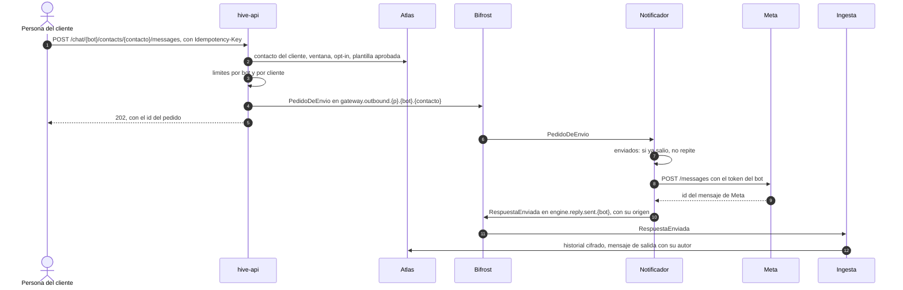

# ADR-0031: El cliente escribe a sus contactos por WhatsApp, y solo el notificador envía

* **Estado:** proposed
* **Fecha:** 2026-10-29
* **Decisores:** Jeremi Alcala
* **Fase AI-DLC:** 02-design
* **Versión:** 0.1.0
* **ID:** ADR-0031
* **Supersede:** —
* **Controles OWASP afectados:** A01 (quién envía y a quién), A04 (el token de Meta sale de la API de gestión hacia
  Meta), A06 (un canal para spam si no se limita), A09 (cada envío, auditado)
* **Requisitos:** RF29–RF31, RS06 (matizado), RS27; AB36–AB42 del [PRD](../../01-requirements/mvp-baas-gateway.md)

Decisiones de Jeremi:
- **2026-10-27, la D10 de la [matriz rol × acción](../../02-design/matriz-rol-accion.md):**
  - el cliente escribe por iniciativa propia solo a contactos que ya existen, y solo por WhatsApp;
  - fuera de la ventana de 24 horas, con plantillas de Meta, que el `cliente-admin` gestiona por la API de Hive;
  - el `cliente-analista` solo envía plantillas aprobadas.
- **2026-10-29:**
  - Hive guarda el consentimiento (opt-in) de cada contacto;
  - Hive limita a 60 envíos por minuto por bot y a 1 000 al día por cliente.

## Contexto

Hasta hoy, Hive solo responde: un mensaje entra por el webhook, el motor lo procesa y el notificador envía la
respuesta ([ADR-0002](0002-el-motor-entrega-las-respuestas.md)). La D10 añade lo contrario: una persona del cliente, o
su credencial de máquina, escribe a un contacto desde la PWA o desde la API.

Lo que fija Meta (documentación consultada el 2026-10-29):

- **La ventana de atención.** Un mensaje del usuario abre una ventana de 24 horas, y cada mensaje nuevo la reinicia.
  Dentro de la ventana se puede enviar texto libre; fuera, solo plantillas aprobadas
  ([mensajes de servicio](https://developers.facebook.com/documentation/business-messaging/whatsapp/messages/send-messages),
  [plantillas](https://developers.facebook.com/documentation/business-messaging/whatsapp/templates/overview),
  [política](https://business.whatsapp.com/policy)).
- **El consentimiento.** Para escribir por iniciativa propia hace falta el consentimiento del destinatario. Debe
  decir claramente que acepta recibir mensajes y el nombre del negocio, y Meta recomienda respetar las bajas por
  categoría ([opt-in](https://developers.facebook.com/docs/whatsapp/overview/getting-opt-in)). Que alguien escribiera
  una vez no es consentimiento.
- **Los permisos del token.** Enviar pide `whatsapp_business_messaging`. Gestionar plantillas pide además
  `whatsapp_business_management`: con el otro solo, Meta responde con el error 200
  ([gestión de plantillas](https://developers.facebook.com/documentation/business-messaging/whatsapp/templates/template-management/)).
- **Los límites.** Meta tiene los suyos: por número, por calidad y, en marketing, por destinatario
  ([límites por usuario](https://developers.facebook.com/documentation/business-messaging/whatsapp/templates/marketing-templates/per-user-limits/)).
  Si se pasan o la calidad baja, el número del cliente queda degradado o bloqueado. Las plantillas se cobran por
  mensaje a la cuenta de WhatsApp del cliente.

Lo que ya hay en Hive:

- **El notificador** envía con el token de cada bot, que pide al gateway (`GET /chat/{bot_id}/tokens`, RS06).
  Recuerda lo que ya envió en el bucket `enviados` de Bifröst para no enviarlo dos veces.
- **Lo que Meta aceptó** vuelve por `RESPUESTAS` (`engine.reply.sent.{botId}`) y el worker de ingesta lo guarda
  cifrado en el historial como mensaje de salida.
- **El historial** guarda los mensajes entrantes de cada contacto, con su hora (RF14).
- **El gateway ya llama a Meta con un token de cliente:** el worker de ingesta pide el perfil de un contacto nuevo de
  Messenger (`src/controller/facebook.py`). RS06 dice que «solo el motor obtiene los tokens»: es cierto de
  *obtenerlos en claro*, no de *usarlos*.

## Decisión

1. **Solo WhatsApp en la v1.** Messenger tiene otra ventana y sus etiquetas, y el notificador todavía no envía por
   Messenger (E10).
2. **El camino del envío.** La API valida, el bus lleva el pedido y solo el notificador envía:

*Eje comportamiento · fase 02. El pedido usa la partición del contacto, así que un envío del cliente y una
respuesta del bot a la misma persona salen en orden (RNF08).*

   - **El pedido no lleva el número del contacto,** solo su identificador. El notificador lo resuelve igual que con las
     respuestas del motor.
   - **El pedido lleva quién lo hizo:** una persona (`sub` de Hive) o la credencial de máquina.
   - **El texto viaja como en el resto del bus** (RS08, RS19).
   - **El sujeto es nuevo, en un stream propio.** Solo `hive-api` publica en él y solo el notificador lo consume
     (RS20).
3. **La ventana** la calcula `hive-api` con el último mensaje entrante del contacto en el historial. Fuera de ella,
   un texto libre se rechaza con `422` y un motivo claro. Meta lo rechazaría también, pero más tarde y sin que la
   persona lo vea.
4. **El consentimiento lo guarda Hive** (decisión del 2026-10-29). Es un dato nuevo del contacto:
   - las categorías que aceptó, `MARKETING` y `UTILITY`;
   - la fecha y el origen del consentimiento, por ejemplo «formulario web», escrito por el cliente;
   - la fecha en que lo retiró, si lo retiró.

   Lo registran y lo retiran el `cliente-admin` o la credencial de máquina; el `cliente-analista` lo ve. Una
   plantilla fuera de la ventana necesita el consentimiento vigente para su categoría. Dentro de la ventana no hace
   falta: la conversación la abrió el contacto. El consentimiento se exporta y se borra con el contacto (RF09).
5. **Los límites de Hive** (decisión del 2026-10-29), además de los de Meta:
   - **60 envíos por minuto por bot y 1 000 al día por cliente,** de texto y de plantilla juntos. Pasarlos responde
     `429` con `Retry-After`, como `/oauth/token` ([ADR-0028](0028-limite-de-peticiones-en-oauth-token.md)).
   - El operador puede subir los dos para un cliente.
   - Los contadores viven en un bucket KV de Bifröst con caducidad, para que no se pierdan al reiniciar `hive-api`.
6. **Un envío no sale dos veces.** La petición lleva una `Idempotency-Key`, que pasa a ser el id del pedido. La misma
   clave en las 24 horas siguientes devuelve el mismo pedido, y el notificador no repite lo que ya está en `enviados`.
7. **Las plantillas las gestiona `hive-api`,** con el token de WhatsApp del bot, contra
   `/{WABA_ID}/message_templates`.
   - El token no sale de `hive-api` ni vuelve a nadie. Esto matiza RS06: el token se usa en el servidor de la API de
     gestión, pero solo el notificador lo obtiene en claro.
   - Hive guarda el `WABA_ID` de cada bot, que no es secreto y hoy no se guarda.
   - **Un solo token por bot,** con los dos permisos. Lo normal es un token de usuario del sistema de Meta. Si le
     falta `whatsapp_business_management`, Hive lo dice al cargarlo y al gestionar plantillas, en lugar de pedir un
     segundo token.
   - Hive guarda una copia de cada plantilla: nombre, idioma, categoría y estado. Se actualiza al gestionarla y con
     el webhook de estados de plantilla (HIG-86).
   - Una plantilla solo se envía si la copia dice `APPROVED`.
   - En la v1, solo `MARKETING` y `UTILITY`: las de autenticación (códigos de un solo uso) no son un caso de Hive.
8. **Cada envío queda en la auditoría del cliente:** quién, qué bot, qué contacto (su identificador), texto o qué
   plantilla, y el resultado. El texto no va a la auditoría ni al log (RS07): va cifrado al historial, como mensaje de
   salida con su autor.
9. **Quién envía, según la matriz:** `cliente-admin` y la credencial de máquina, texto y plantillas; `cliente-analista`,
   solo plantillas aprobadas; el operador, nada en los bots de otro cliente.

## Alternativas consideradas

| Opción | Pros | Contras |
|---|---|---|
| **La API publica el pedido y el notificador envía** (elegida) | Un solo sitio que habla con Meta para enviar y tiene el token en claro (RS06). Reaprovecha la deduplicación, el orden y la vuelta al historial | Un sujeto y un stream nuevos, y el envío es asíncrono: la API responde `202` y el resultado llega después |
| `hive-api` envía directamente a Meta | Respuesta inmediata | Dos sitios que envían, con su token en claro y sin el orden respecto a las respuestas del bot. Hay que rehacer la deduplicación y la vuelta al historial |
| El cliente declara el consentimiento en sus condiciones | Más simple | Hive no puede frenar un envío sin consentimiento ni demostrar nada ante Meta o una autoridad de datos |
| Un segundo token por bot, solo para plantillas | Mínimo privilegio | Meta da los dos permisos al mismo token de usuario del sistema, y dos tokens por bot doblan la carga y la rotación de credenciales. Queda como revisión si un cliente lo pide |
| Solo los límites de Meta | Nada que construir | Una sesión robada o un error del cliente quema el número, y la factura de plantillas, antes de que nadie lo vea |

## Consecuencias

- **El contrato del bus gana el `PedidoDeEnvio`,** un stream y un sujeto, con su usuario de Bifröst: `hive-api`
  publica y el notificador consume.
- **`RespuestaEnviada` gana su origen:** si fue una respuesta del bot o un envío del cliente, y quién lo hizo. El
  historial guarda el autor.
- **El contacto gana su consentimiento** y el bot su `WABA_ID`. Los dos se exportan y se borran con el resto.
- **`hive-api` llama a Meta** para gestionar plantillas: una dependencia y un tiempo de espera nuevos.
- **El cliente paga en Meta cada plantilla.** Los límites de Hive protegen también su factura.
- **La matriz rol × acción, sección 7, pasa a apuntar a RF29–RF31,** y se añaden las filas del consentimiento.
- **Las tareas que salen de aquí:**
  - HIG-83, la ruta de envío en `hive-api`;
  - HIG-84, el notificador que envía texto y plantillas;
  - HIG-85, la gestión de plantillas;
  - HIG-86, el webhook de estados de plantilla;
  - HIG-87, la PWA.

## Condiciones de revisión

- Messenger o Instagram entran en los envíos del cliente.
- Un cliente necesita más de 1 000 envíos al día de forma habitual, o campañas.
- Meta cambia la ventana, el precio de los mensajes de servicio o las reglas del consentimiento.
- Un cliente pide un token aparte para gestionar plantillas.
- Meta degrada la calidad de un número de un cliente de Hive.
