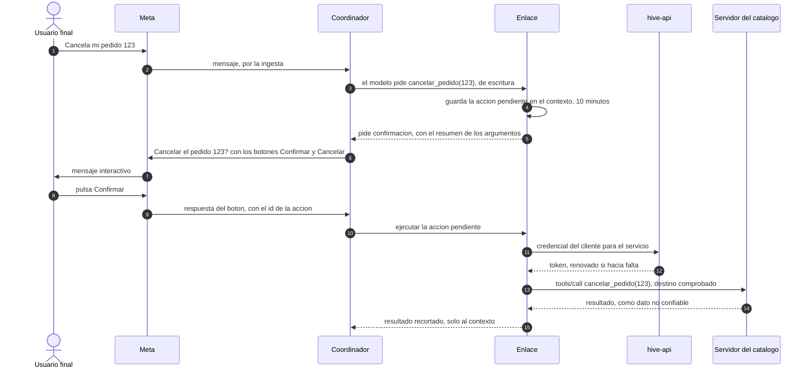

# ADR-0032: Los servicios de terceros entran por un catálogo MCP del operador, y solo el enlace los llama

* **Estado:** proposed
* **Fecha:** 2026-10-29
* **Decisores:** Jeremi Alcala
* **Fase AI-DLC:** 02-design
* **Versión:** 0.1.0
* **ID:** ADR-0032
* **Supersede:** —
* **Controles OWASP afectados:** A01 (qué herramienta puede usar cada bot), A04 (las credenciales del cliente), A05 y
  A06 (inyección de instrucciones y herramientas envenenadas), A08 (un servidor MCP que cambia lo que ofrece), A10
  (llamadas a destinos que escribe otro)
* **Requisitos:** RF32–RF35, RS28–RS29; AB43–AB49 del [PRD](../../01-requirements/mvp-baas-gateway.md)

Decisiones de Jeremi:
- **2026-10-26, la D7 y la D8 de la [matriz rol × acción](../../02-design/matriz-rol-accion.md):**
  - MCP entra para integrar Hive con servicios de terceros;
  - el operador configura los servidores MCP por defecto;
  - el `cliente-admin` carga las credenciales de su cuenta y configura integraciones con sus propias APIs;
  - las llamadas las hace el enlace.
- **2026-10-29:**
  - las integraciones conviven con los intents y comparten el almacén de credenciales;
  - una herramienta con efectos la confirma el usuario final antes de ejecutarse;
  - los servicios que lo exigen se conectan por OAuth ya en la v1.

## Contexto

**Lo que ya hay en Hive:**
- **Los intents.** Cada acción de un intent declara su llamada HTTP (`apiCall`): método, URL, cabeceras, cuerpo,
  tiempo de espera y un `authType` con su `authRef`. El gateway solo guarda y entrega destinos que no pueden ser la
  plataforma ([destinos de los intents](../../03-implementation/destinos-de-los-intents.md), RS16, AB09). El enlace
  tendrá que comprobarlos otra vez en cada llamada.
- **El `authRef` es solo un nombre.** No hay ningún almacén detrás: ninguna credencial de un intent tiene dónde vivir.
- **El enlace (E9 del motor)** es el worker que tiene `GET /chat/{bot_id}/tools` y hará las llamadas
  ([ADR-0022](0022-una-credencial-por-worker.md)). Todavía no existe.

**Lo que dice la especificación de MCP,** en su última versión final, la 2025-11-25
([cambios](https://modelcontextprotocol.io/specification/2025-11-25/changelog)):
- **El transporte remoto es Streamable HTTP:** un único punto, que acepta `POST`
  ([transporte](https://modelcontextprotocol.io/specification/draft/basic/transports/streamable-http)).
- **La autorización de un servidor remoto** se basa en OAuth 2.1.
- **Las anotaciones de una herramienta** (`readOnlyHint`, `destructiveHint`) **son pistas, no garantías.** El
  cliente no debe decidir con ellas si el servidor no es de confianza
  ([herramientas](https://modelcontextprotocol.io/specification/2026-07-28/server/tools)).
- **Hay una revisión 2026-07-28 en fase de candidata.** Esta ADR no se apoya en ella.

**Los riesgos propios de MCP:**
- **La descripción de una herramienta entra al modelo.** Un servidor que la cambia puede meterle instrucciones: es el
  envenenamiento de herramientas, o la herramienta que cambia después de aprobada.
- **Lo que responde una herramienta también entra al modelo,** y puede traer datos personales.

## Decisión

1. **Dos clases de integración, una sola forma de llamar.**
   - **Las APIs del cliente siguen siendo las llamadas HTTP declaradas de los intents,** con sus destinos validados.
     El cliente no conecta servidores MCP propios en la v1: sus herramientas y sus descripciones las escribiría él.
   - **Los servicios de terceros entran por el catálogo MCP del operador.**
   - Las dos las ejecuta solo el enlace.
2. **El catálogo del operador.** Cada servidor del catálogo es un servidor MCP **remoto, por Streamable HTTP y
   `https`**. Lleva:
   - su URL;
   - la versión de MCP: 2025-11-25;
   - **la lista cerrada de herramientas** que se pueden ofrecer. De cada una, su nombre, la huella (SHA-256) de su
     descripción y de su esquema de entrada, y una clase que pone el operador: **lectura** o **escritura**. Nunca se
     deduce de las anotaciones del servidor;
   - cómo se autentica la cuenta del cliente: con una clave fija o por OAuth;
   - en el caso de OAuth, los permisos (*scopes*) mínimos.

   En la v1 no hay servidores locales (`stdio`): serían código de terceros dentro de la plataforma.
3. **Una herramienta que cambia no se ofrece.** Al conectar, el enlace lista las herramientas del servidor y solo
   ofrece al modelo las que están en el catálogo con la misma huella. Si aparece una nueva, o cambia una descripción o
   un esquema:
   - esa herramienta queda fuera hasta que el operador la vuelva a aprobar;
   - queda en la auditoría de la plataforma (RF20) y avisa al operador.
4. **El cliente activa, por bot, lo que quiere:**
   - el `cliente-admin` activa un servidor del catálogo en un bot y elige qué herramientas del catálogo usa;
   - el `cliente-analista` ve qué integraciones tiene cada bot, sin sus credenciales;
   - el operador no ve las integraciones ni las credenciales de un cliente (D8).

   Cada cambio crea una versión del bot (RF26).
5. **Un solo almacén de credenciales por cliente,** para los intents y para el catálogo:
   - cifradas con la clave de datos del cliente, como las de Meta (RS06), y sin volver a mostrarse;
   - cada una tiene un nombre, y el `authRef` de un intent apunta a ese nombre;
   - se borran con el cliente (RF10);
   - **solo el enlace las obtiene en claro,** con una ruta nueva que está solo en sus `WORKER_ROUTES`, y cada entrega
     queda en el log, como los tokens de Meta.
6. **OAuth en la v1,** para los servicios del catálogo que lo exigen (decisión del 2026-10-29):
   - **Hive se registra como aplicación** en cada servicio. El operador guarda en Andvari el secreto de esa aplicación,
     no en la base.
   - **El `cliente-admin` conecta su cuenta desde la PWA.**
     - El BFF hace el flujo Authorization Code con PKCE y `state`.
     - La redirección vuelve a `https://hive-app.higerotech.com/integraciones/callback`.
     - `hive-api` canjea el código y guarda los tokens en el almacén del punto 5.
   - **Los permisos son los del catálogo.** El cliente no puede pedir más.
   - **`hive-api` renueva el token** cuando el enlace lo pide y le queda menos de un minuto, y respeta la rotación del
     token de renovación. Si la renovación falla, la integración queda como desconectada y se avisa al cliente.
   - **Desconectar** revoca el token en el servicio, si este lo admite (RFC 7009), y lo borra de Hive.
   - Un servidor MCP que pide OAuth recibe ese mismo token como *bearer*.
7. **Lo que tiene efectos lo confirma el usuario final** (decisión del 2026-10-29):
   - **El enlace no ejecuta una herramienta de escritura,** ni una acción de intent con un método distinto de `GET`,
     cuando el modelo la pide. Guarda la acción pendiente en el contexto de la conversación, que caduca a los 10
     minutos.
   - **El bot pide la confirmación** con un resumen hecho a partir de los argumentos de la llamada, no con la prosa del
     modelo.
   - **Se confirma con botones** de *Confirmar* y *Cancelar* (respuesta interactiva de WhatsApp y respuestas rápidas
     de Messenger e Instagram). El botón lleva el identificador, no adivinable, de la acción pendiente.
   - **Un «sí» escrito no basta:** el mismo mensaje que intenta la inyección podría traerlo.
   - **La confirmación solo vale** para esa acción, en esa conversación y antes de que caduque.
8. **Lo que responde una herramienta es entrada no confiable** (AB08):
   - entra al modelo marcado como dato, nunca como instrucción;
   - se recorta a 16 KiB;
   - pasa por la base de guardrails (RS26);
   - **no se guarda** en el historial, en los logs ni en las trazas (RS07, RS19). Solo vive en el contexto de la
     conversación, que caduca a las 24 horas (RNF05).
9. **Las llamadas, como las de los intents:**
   - el enlace resuelve el nombre, comprueba cada dirección, conecta a la dirección comprobada y no sigue redirecciones;
   - el tiempo de espera va de 1 a 30 segundos;
   - como mucho, **tres llamadas por mensaje.**

   Cada llamada queda en la auditoría del cliente: qué bot, qué herramienta, su clase, si se confirmó y el resultado,
   sin argumentos ni respuesta.

*Eje comportamiento · fase 02. Una herramienta de escritura no se ejecuta con lo que pide el modelo, sino con el botón
que pulsa el usuario. Una de lectura salta del paso 3 al 11 sin confirmación.*

## Alternativas consideradas

| Opción | Pros | Contras |
|---|---|---|
| **Catálogo MCP del operador, y las APIs del cliente como llamadas declaradas** (elegida) | Los intents no se reescriben, y una API del cliente sigue limitada a un método, una URL y un esquema. El código de terceros que entra lo aprueba el operador, herramienta por herramienta | Hay dos formas de integrar, con una sola credencial y un solo enlace |
| MCP sustituye a los intents, y el cliente publica su API como servidor MCP | Un solo mecanismo | Reescribir los intents. Las descripciones de las herramientas, que entran al modelo, las escribiría cada cliente: el envenenamiento queda en manos de quien menos se controla |
| Confiar en las anotaciones del servidor | Nada que mantener | La especificación dice que son pistas y no se deben usar con servidores que no son de confianza |
| Ejecutar las herramientas de escritura sin confirmación | La conversación fluye mejor | Una inyección de instrucciones lanza acciones reales a nombre del cliente |
| Confirmación con un «sí» escrito | No depende de los botones del canal | El mismo texto malicioso puede traer el «sí» |
| Solo claves fijas en la v1 | Nada que renovar ni registrar | Deja fuera los servicios que solo aceptan OAuth (Google, Microsoft) |
| Credenciales en Andvari, una ruta por cliente | Un gestor de secretos de verdad | Otra copia de los datos de cada cliente fuera de su clave de datos, y la baja del cliente tendría que borrar en dos sitios. Andvari guarda lo de la plataforma, como el secreto de la aplicación OAuth |

## Consecuencias

- **El enlace se construye con un cliente MCP** de la especificación 2025-11-25. El plan lo pone en Rust, con `rmcp`.
  Además, el enlace comprueba las huellas y guarda las acciones pendientes.
- **`hive-api` gana:**
  - el catálogo, que es del operador;
  - las integraciones de cada bot;
  - el almacén de credenciales, con su ruta para el enlace;
  - el canje, la renovación y la revocación de OAuth;
  - el `authRef` de los intents, que por fin apunta a algo.
- **El BFF gana la ruta `/integraciones/callback`.** Hay que registrarla en cada servicio con OAuth, igual que la de
  Zitadel.
- **Los canales necesitan botones:**
  - el notificador envía mensajes interactivos;
  - la ingesta entiende la respuesta de un botón y la lleva a la acción pendiente.
- **Cada servicio con OAuth es un subencargado** del cliente para lo que le pase Hive, y lo que responde puede traer
  datos personales. El contrato de encargo tiene que nombrarlos.
- **La matriz rol × acción, sección 8, pasa a apuntar a RF32–RF35.**

## Condiciones de revisión

- Un cliente pide conectar su propio servidor MCP.
- La revisión 2026-07-28 de MCP pasa a final y cambia el transporte o la autorización.
- Un servicio del catálogo necesita un servidor local.
- Las confirmaciones por botón resultan incómodas para algún caso, por ejemplo acciones de bajo riesgo repetidas.
- Un servicio con OAuth deja de admitir la revocación o la rotación de los tokens de renovación.
