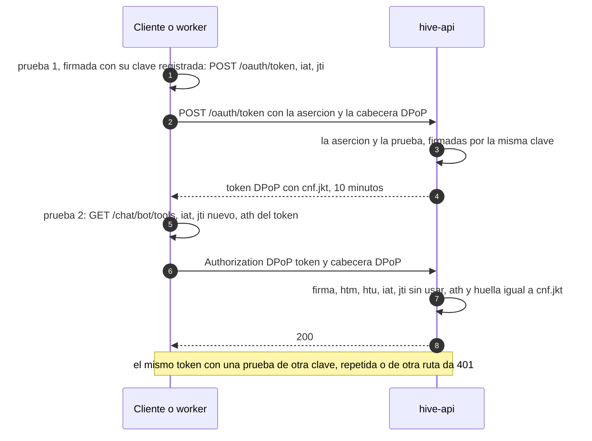

# ADR-0033: Los tokens de acceso de Hive van atados por DPoP a la clave que los pidió

* **Estado:** accepted
* **Fecha:** 2026-10-29
* **Decisores:** Jeremi Alcala
* **Fase AI-DLC:** 02-design
* **Versión:** 1.0.0
* **ID:** ADR-0033
* **Supersede:** — (completa la [ADR-0025](0025-oauth2-client-credentials-con-private-key-jwt.md), que dejó DPoP
  pendiente)
* **Controles OWASP afectados:** A07 (un token robado deja de servir), A01 (el token del notificador alcanza los
  tokens de Meta), A04 (las claves que firman cada prueba)
* **Requisitos:** RS02 (ampliado), RS30; AB50–AB51 del [PRD](../../01-requirements/mvp-baas-gateway.md)

Decisiones de Jeremi del 2026-10-29:
- el token de una credencial de máquina se ata a la clave registrada que firmó su aserción;
- el motor también usa DPoP;
- el cambio se hace de golpe, como el de la ADR-0025.

## Contexto

Desde la ADR-0025, un cliente pide un token de acceso con una aserción firmada y cifrada, y lo usa durante 10
minutos. **Es un token de portador:** quien lo robe lo usa en cualquier petición hasta que caduca. La ADR-0025 dejó
DPoP (RFC 9449) «para cuando haya clientes externos», y el primer cliente real lo es.

**El token que más vale es el del notificador:** con él se obtienen en claro los tokens de Meta de los bots de un
cliente (`GET /chat/{bot_id}/tokens`, RS06).

**Lo que la ADR-0025 quitó fue firmar en cada petición.** DPoP lo trae de vuelta, así que lo medí el 2026-10-29 en
midgard. Usé un contenedor desechable de la imagen de `hive-api`, sin red y con media CPU, que es su límite, en el Intel
i3-3240, con `jwcrypto`, la biblioteca que ya usa Hive:

| Operación | Tiempo medio (2 000 veces) |
|---|---|
| Firmar una prueba `ES256` (`dpop+jwt`, con `jti`, `htm`, `htu`, `iat` y `ath`) | 0,9 ms |
| Verificarla y calcular la huella de su clave | 1,7 ms |

Una prueba ocupa 548 bytes. El coste es despreciable frente a lo que tarda un mensaje (RNF01) y frente a la consulta a
Atlas que hace cada petición. Lo que la ADR-0025 sí quitó, y DPoP no devuelve, es la escritura en la base en cada
petición: el `jti` de una prueba no se guarda en Atlas (punto 4).

## Decisión

1. **Todo token de acceso de Hive va atado a una clave** (RFC 9449). El token lleva `cnf.jkt`, la huella SHA-256 de la
   clave pública (RFC 7638), y su tipo pasa a ser `DPoP`. `hive-api` deja de aceptar `Authorization: Bearer`.
2. **¿Qué clave?**
   - **Una credencial de máquina, de un cliente o de un worker del motor, usa su clave registrada:** la P-256 con la
     que firmó la aserción del token (`hive_key`). En `/oauth/token`, la prueba DPoP tiene que venir firmada por esa
     misma clave. Si no, `invalid_dpop_proof`.
   - **El BFF** (`hive-portal`, ADR-0029) no tiene clave de cliente. Usa un par P-256 suyo, que genera al arrancar y
     guarda solo en memoria. Si se reinicia, vuelve a hacer el intercambio con el ID token de cada sesión.
3. **Cómo se pide el token.** `POST /oauth/token` lleva la cabecera `DPoP` con una prueba para ese método y esa URL,
   sin `ath`. El token sale con `"token_type": "DPoP"`.
4. **Cómo se comprueba cada petición** (RFC 9449, §4.3). Lleva `Authorization: DPoP <token>` y la cabecera `DPoP`.
   `hive-api` comprueba, en este orden:
   1. una sola cabecera `DPoP`, con `typ: dpop+jwt` y `alg: ES256`, y una `jwk` pública de P-256 sin parte privada;
   2. la firma, con esa `jwk`;
   3. **`htm`**, el método de la petición;
   4. **`htu`**, la URL de la petición sin consulta ni fragmento. Valen las bases configuradas de `hive-api`: la pública,
      `https://hive-api.higerotech.com`, y la interna que usa el motor dentro de midgard;
   5. **`iat`**, en los últimos 60 segundos o hasta 5 segundos en el futuro, y posterior al arranque del proceso;
   6. **`jti`**, sin usar. Se guarda en memoria durante esa ventana, nunca en Atlas;
   7. **`ath`**, el hash SHA-256 del token que acompaña;
   8. que la huella de la `jwk` sea el `cnf.jkt` del token.

   **El `iat` posterior al arranque** cierra la única grieta de guardar el `jti` en memoria: tras un reinicio, una
   prueba de antes no vale. `hive-api` corre en una sola instancia. Si un día son varias, el `jti` pasa a un bucket KV
   de Bifröst con caducidad.
5. **Los errores** siguen el RFC: `401` con `WWW-Authenticate: DPoP error="invalid_token"` o `"invalid_dpop_proof"`,
   y `algs="ES256"`. Como hoy, no se dice qué comprobación falló ni se repite lo enviado (RS15).
6. **Sin `DPoP-Nonce` en la v1.** El nonce del servidor acorta todavía más la ventana, pero cuesta una ida y vuelta más
   en la primera petición de cada token. Con 60 segundos y el `jti` de un solo uso basta.
7. **El motor también,** cada worker con su clave por cliente (ADR-0016, ADR-0022). Firma una prueba por petición
   (0,9 ms) y guarda el token como hoy, hasta un minuto antes de que caduque.
8. **De golpe:** el gateway, el motor, `ops.client` y `ops.engine_keys` cambian en el mismo PR y se despliegan juntos.
   El cliente externo cambia el mismo día, coordinado con él. Desde ese despliegue, un token sin prueba se rechaza.
9. **Lo que no cambia:**
   - el webhook, que se autentica con la firma de Meta;
   - la aserción firmada y cifrada de la ADR-0025;
   - los 10 minutos de vida del token;
   - el límite de `/oauth/token` (ADR-0028).

*Eje comportamiento · fase 02. Una prueba por petición; el token sirve 10 minutos, pero solo a quien tiene la clave.*

## Alternativas consideradas

| Opción | Pros | Contras |
|---|---|---|
| **DPoP con la clave registrada** (elegida) | Un token robado no sirve sin la clave privada del cliente, y no hay ninguna clave nueva que gestionar | El cliente firma en cada petición: 0,9 ms medidos |
| DPoP con una clave efímera, la que el cliente quiera | Es lo más flexible del RFC 9449 | No protege más: quien roba la clave registrada ya puede pedir tokens. Y el servidor no puede comprobar que la clave sea del cliente |
| mTLS (RFC 8705) | El TLS ata el token sin firmar nada por petición | El TLS termina en Cloudflare, antes del túnel: `hive-api` nunca ve el certificado del cliente |
| Tokens de portador más cortos, por ejemplo de 1 minuto | Nada nuevo que construir | Un token robado sigue sirviendo, aunque menos rato, y el cliente pide diez veces más tokens |
| Solo para los clientes externos | Menos cambios en el motor | El token del notificador, que da los tokens de Meta, sigue de portador |
| Opcional durante un plazo | No rompe nada el día del cambio | Dos caminos de entrada durante semanas, como ya descartó la ADR-0025 |
| `jti` en Atlas | Sobrevive a un reinicio | Devuelve la escritura por petición que quitó la ADR-0025. Con el `iat` posterior al arranque no hace falta |

## Consecuencias

- **Para un cliente:** en cada petición construye una prueba con la misma librería JOSE con la que firma la aserción,
  o con `ops.client`. La documentación pública de la API (ADR-0026) lo explica con un ejemplo.
- **El contrato OpenAPI** declara el esquema `DPoP` en lugar de `bearer`.
- **`hive-api` guarda los `jti` en memoria,** unos pocos miles en un minuto como mucho.
- **Las pruebas** cubren los cuatro rechazos de la tarea y algunos más:
  - un token sin prueba;
  - una prueba de otra clave;
  - una prueba repetida;
  - una prueba para otra ruta o con otro método;
  - un `ath` de otro token;
  - un `iat` fuera de la ventana o anterior al arranque.
- **RS02 pasa a decir que el token va atado.** La ADR-0025 deja DPoP como resuelto en sus condiciones de revisión.

## Condiciones de revisión

- `hive-api` pasa a varias instancias: el `jti`, a Bifröst.
- Un cliente no puede firmar en cada petición, por ejemplo un dispositivo sin acceso a su clave.
- Se mide en producción un coste mayor que el de midgard.
- El TLS deja de terminar en Cloudflare y mTLS se vuelve posible.
