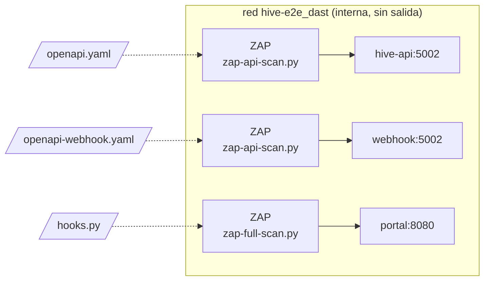

# DAST con OWASP ZAP

* **Estado:** review
* **Fecha:** 2026-10-30
* **Decisores:** Jeremi Alcala
* **Fase AI-DLC:** 04-testing
* **Versión:** 1.0.0

OWASP ZAP ataca a Hive desde fuera, como lo haría alguien sin credenciales (HIG-90, Gate 3). Lo hace contra el stack
de la [prueba de punta a punta](e2e.md), con las imágenes de producción construidas del mismo commit. Está en
`tests/e2e/test_dast.py` y corre en el job `dast · zap` del workflow `e2e`:
- en cada PR a `main`, que son las releases;
- en los PR a `develop` que cambian la prueba de punta a punta, el portal o el despliegue;
- y a mano.

Corre a la vez que el job de la prueba de punta a punta, con su propio stack: no alarga lo que tarda el workflow.



## Qué se escanea

Tres escaneos a la vez, cada uno en su contenedor de ZAP:

| Objetivo | Cómo | Qué recorre |
|---|---|---|
| `hive-api` | `zap-api-scan.py` con `docs/02-design/contracts/openapi.yaml` | Las 47 operaciones del contrato: escaneo pasivo y activo (la política `API-Minimal` de ZAP) |
| El webhook | `zap-api-scan.py` con `docs/02-design/contracts/openapi-webhook.yaml` | La verificación de Meta, las notificaciones y `/health` |
| `hive-portal` | `zap-full-scan.py`, con un minuto de spider | La PWA entera, sus ficheros y las rutas propias del portal: el login, su callback, la sesión, el logout y `/api/...`; escaneo pasivo y activo (la política por defecto) |

**El portal:** la PWA pinta sus páginas con JavaScript, y el spider de ZAP no ve en ella las rutas del portal.
`tests/e2e/zap/hooks.py` las visita una vez, sin sesión, al arrancar ZAP: así el spider y el escaneo activo también
parten de ellas. El login redirige al Zitadel falso, que queda fuera: no es de Hive, y no está en la red de ZAP.

**Además, sin ZAP:** `test_every_route_that_asks_for_a_token_answers_401_without_one` recorre cada operación del
contrato que pide token. Sin cabecera, con un `DPoP` que no es un token y con un `Bearer`, todas tienen que responder
`401`.

## Qué no se escanea

- **Las rutas de `hive-api` con token.** ZAP no sabe firmar una prueba DPoP por petición (RFC 9449, ADR-0033), así
  que no llega más allá del `401`. Lo que hay detrás lo prueban las suites de seguridad y de aislamiento, con tokens
  de verdad (`tests/security/`, [matriz OWASP](../../.ai-dlc/owasp-mapping.md)).
- **La PWA con sesión:** sin login no hay cookie `__Host-hive-session`, y `/api/...` responde `401`.
- **El motor:** no escucha a nadie; solo habla con Bifröst.
- **Zitadel, Meta y el LLM:** son los falsos de `tests/e2e/fakes.py`.
- **El túnel y Cloudflare:** ZAP llega a los servicios directamente.

## Cómo no sale de la máquina

- **La red `dast` es interna** (`tests/e2e/compose.yaml`): solo tiene a `hive-api`, al webhook y al portal, y Docker
  no le da salida. Nada de lo que manda ZAP puede llegar a producción ni a ningún otro sitio.
- **Los contratos apuntan a producción** (`servers`). La prueba escribe una copia con la dirección del servicio en la
  red de la prueba, y ZAP lee esa.
- **`-silent`:** ZAP no busca ni instala add-ons de internet. Lo que corre es lo que trae la imagen, fijada por digest
  en `tests/e2e/test_dast.py`.

## Cuándo falla

**Falla con un hallazgo High.** La prueba lee el informe JSON de cada escaneo y falla si hay una alerta de riesgo
High (`riskcode` 3) que `tests/e2e/zap/rules.tsv` no acepta.

Medium, Low e Informational no lo hacen fallar: quedan en el informe. ZAP corre con `-I`, así que sus avisos no
cambian el código de salida. Ese código solo hace fallar la prueba si es un error de ZAP o si no encontró nada que
escanear (`3`).

**Por qué la prueba y no ZAP:** el fichero de reglas de ZAP decide FAIL o WARN por regla, no por riesgo. Habría que
listar cada regla que puede dar High, y una regla nueva de la imagen entraría como WARN sin avisar. El `riskcode` del
informe no depende de esa lista.

### Los falsos positivos aceptados

Van en `tests/e2e/zap/rules.tsv`, con el formato del fichero de reglas de ZAP, un TAB entre campos:

```
# Por qué es un falso positivo; quién lo aceptó y cuándo.
<id de la regla>	IGNORE	(<nombre de la regla>)
# ...
<id de la regla>	OUTOFSCOPE	<regex de la URL>
```

- **`IGNORE`** acepta todas las alertas de esa regla, en los tres objetivos.
- **`OUTOFSCOPE`** acepta solo las de las URL que casan con la expresión desde su principio.
- **Cada entrada lleva su motivo** en un comentario encima. `test_each_accepted_false_positive_says_why` falla si
  falta, o si una línea no tiene ninguna de las dos formas; corre también en la suite unitaria, sin Docker.
- **El fichero no se le pasa a ZAP:** `zap-api-scan.py` cambia de política de escaneo en cuanto recibe uno, y lo que
  corre no debe depender de lo que se acepta. Solo decide qué High hacen fallar el job.

**Hoy no hay ninguno.**

## Los informes

En `$DAST_REPORTS` (`.e2e/dast` por defecto), una carpeta por objetivo:
- **`<objetivo>.html`, `<objetivo>.json` y `<objetivo>.md`:** los informes de ZAP, con cada alerta y dónde salió;
- **`zap.out`:** lo que imprimió ZAP;
- **`summary.md`:** las alertas por riesgo de los tres objetivos.

En el CI, el resumen va también al resumen del job, y la carpeta se adjunta a la ejecución como el artefacto
`dast-zap`, durante 30 días. Se adjunta también si la prueba falla.

## Cómo se corre

```sh
pip install --require-hashes -r tests/e2e/requirements.lock
DAST=1 E2E=1 BIFROST_DIR=../bifrost pytest tests/e2e/test_dast.py
```

- **Sin `DAST=1`** los escaneos se saltan: el job de la prueba de punta a punta no los corre.
- **`E2E_NO_BUILD=1`** no reconstruye las imágenes, como en la prueba de punta a punta.
- **`BIFROST_DIR`:** la copia de Bifröst, con sus ficheros con LF (ver [e2e](e2e.md#cómo-se-corre)).
- **En Windows,** con Docker Desktop, igual.

## El primer resultado

El 2026-10-30, en local con Docker Desktop, sobre `develop` con los límites de HIG-139 y con ZAP 2.17.0 (`stable`
del 2026-10-26):

| Objetivo | High | Medium | Low | Informational | URL que vio ZAP |
|---|---|---|---|---|---|
| `hive-api` | 0 | 0 | 0 | 1 | 125 |
| El webhook | 0 | 0 | 0 | 1 | 31 |
| `hive-portal` | 0 | 0 | 0 | 3 | 31 |

Las 135 peticiones sin token a las 45 operaciones con token dieron `401`.

Las informativas, que no piden nada:
- **`hive-api` y el webhook, «A Client Error response code was returned by the server» [100000]:** los `401` y `404`
  de lo que ZAP prueba sin token y con ids inventados. Es lo esperado.
- **El portal, «Session Management Response Identified» [10112]:** la cookie `__Host-hive-login` del login, que ZAP
  reconoce como de sesión. Es la del inicio de sesión, con `HttpOnly`, `Secure` y `SameSite=Lax`.
- **El portal, «Modern Web Application» [10109]:** la PWA es una aplicación de JavaScript. Solo avisa de que el
  spider clásico ve poco; por eso `hooks.py` siembra las rutas.
- **El portal, «Information Disclosure - Suspicious Comments» [10027]:** un comentario de `app.js` que dice de dónde
  sale `window.Hive`. No revela nada.

Ninguna regla pasiva de cabeceras saltó: el portal ya mandaba las suyas, y `hive-api` y el webhook las mandan desde la
0.6.0 (HIG-138).

**Los límites le cierran el paso a ZAP,** como a cualquiera que pruebe sin credenciales:
- **`POST /oauth/token`** (ADR-0028): tras unos pocos fallos, el origen de ZAP recibe `429`. `hive-api` rechazó así
  456 peticiones de token en el escaneo.
- **El webhook** (HIG-139): tras 20 peticiones sin firma en un minuto, por worker, también `429`. Rechazó 280.
- **El resto de `hive-api`** no cuenta los `401` de ZAP: solo cuenta por origen lo que llega con la cabecera de
  Cloudflare.

Así que, en esas dos rutas, el escaneo activo ve sobre todo el límite, que es lo que vería un atacante. Lo que hay
detrás lo prueban las suites con la aplicación en proceso (`tests/security/test_hostile_input.py`,
`tests/unit/test_token_limits.py`). Hacer que el stack de la prueba relaje los límites cambiaría la configuración que se
escanea, y no se hizo.

**Cuánto tarda:** 6 min 44 s en local, construyendo las imágenes, y 5 min 38 s con ellas ya construidas. Los tres
escaneos van a la vez. `hive-api` y el webhook acaban en algo más de un minuto, y el portal, con su escaneo activo, en
unos cinco.

## Lo que se vio al montarlo

- **Con un fichero de reglas, `zap-api-scan.py` cambia de política:** deja `API-Minimal` y pasa a la política por
  defecto, con todas las reglas activas. Contra `hive-api` pasó de algo más de un minuto a más de ocho sin acabar, con
  5 GB de memoria, y se paró. Por eso `rules.tsv` no se le pasa a ZAP.
- **Un `500` del portal al iniciar sesión si no llega a Bifröst.** En una prueba a mano, con el stack levantado pero
  sin el directorio de los secretos, `/auth/login` no pudo abrir el KV de sesiones. El portal respondió el `500` en
  texto plano de Starlette, sin traza, en vez de su página de «no está disponible». ZAP lo marcó como Low (90022 y
  10023). Con el stack bien montado no pasa. Queda como observación: en producción solo pasaría con Bifröst caído.
