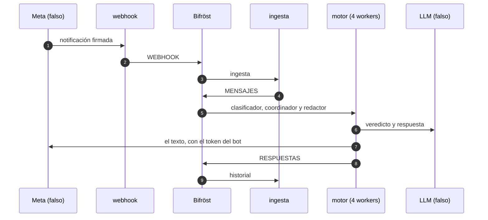
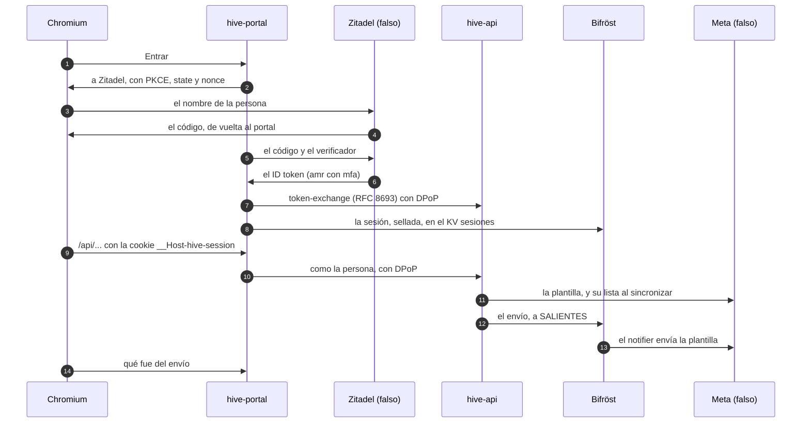

# Prueba de punta a punta: del webhook a la respuesta

* **Estado:** review
* **Fecha:** 2026-10-30
* **Decisores:** Jeremi Alcala
* **Fase AI-DLC:** 04-testing
* **Versión:** 1.1.0

Una persona escribe a un bot y recibe su respuesta, pasando por cada pieza de producción (HIG-135, Gate 3). Y una
persona del cliente entra en la PWA, crea una plantilla y se la envía a un contacto, en un navegador de verdad
(HIG-141, [más abajo](#el-recorrido-de-la-pwa)). Está en `tests/e2e/` y corre en el workflow `e2e`:
- en cada PR a `main`, que son las releases;
- en los PR a `develop` que cambian la prueba, el portal o el despliegue;
- y a mano.



## Qué se levanta

`tests/e2e/compose.yaml`, como en midgard:
- **Las imágenes:** las del gateway, del motor y del portal, construidas del mismo commit.
- **Los servicios:** `hive-api`, `webhook` e `ingest`, los cuatro workers del motor y `hive-portal`.
- **El modo de producción:** `ENVIRONMENT=production`, con TLS hacia Bifröst y Andvari, y los workers de solo lectura
  y sin capacidades.

Alrededor, lo que en producción es de fuera:

| Pieza | En la prueba | Igual que en producción |
|---|---|---|
| Bifröst | NATS 2.14.8 con `nats/bifrost.conf` y `jetstream/aprovisionar.sh` del repo `higerotech/bifrost` | Los usuarios, los permisos, los streams, los consumidores y los buckets |
| Andvari | OpenBao 2.7.1 con TLS, inicializado y abierto por la prueba | Transit `clientes`, las AppRoles `gateway`, `motor-claves`, `motor-coordinator` y `motor-notifier` y el KV `motor` |
| Atlas | MongoDB 7.0 | La base, sin réplicas |
| Hermod | RabbitMQ 4.3.5 | La cola `llm`, mientras la ingesta siga enviando el sobre viejo |
| Meta y el LLM | `tests/e2e/fakes.py`, que guarda lo que le pidieron | Las rutas y las respuestas de la Cloud API, de sus plantillas y de `/v1/chat/completions` |
| Zitadel | `tests/e2e/fakes.py`, en `http://zitadel.e2e.test:18090` | El descubrimiento, el JWKS, el login con PKCE y `client_secret_basic`, el ID token RS256 con `nonce` y `amr`, el logout y la User Service v2 con la que `hive-api` invita |
| El túnel | El portal en `http://localhost:15004` | Lo que ve el navegador: las cookies `__Host-`, la CSP y el origen |

## Cómo se prepara

Lo hace `tests/e2e/conftest.py`, en el orden en que lo haría un operador:

1. **Los secretos nacen en un directorio temporal:**
   - una CA y el certificado de NATS y OpenBao;
   - una contraseña hexadecimal por usuario de Bifröst, como las de su `instalar.sh`, porque NATS no acepta un `-`;
   - las claves del gateway y la del operador;
   - el secreto del portal en Zitadel, la clave de sus sesiones, la clave RSA de Zitadel y el token de la cuenta de
     servicio de `hive-api`.
2. **OpenBao** se inicializa, se abre y se configura como Andvari.
3. **Bifröst** se aprovisiona con su propio script, dentro de nats-box.
4. **El gateway y el portal arrancan.** Se registra la clave del operador (`ops.operator_key`), que da de alta un
   cliente. El cliente crea su bot, carga las credenciales (con su `wabaId`) y una regla, y `ops.engine_keys` le crea
   las claves del motor.
5. **El motor arranca,** y se comprueba que sus cuatro workers siguen vivos.

## Qué comprueba

`tests/e2e/test_del_webhook_a_la_respuesta.py`:

- **Una notificación firmada llega hasta la respuesta:**
  - Meta recibe el texto que escribió el LLM, desde el número del bot y con su token;
  - el LLM recibe una llamada del clasificador y una del redactor, con su clave;
  - el historial tiene el mensaje y la respuesta, con `inReplyTo`;
  - el bot queda en `ACT` (HIG-75).
- **Una notificación firmada con otro secreto da `403`,** y no llega nada a Meta.

## El recorrido de la PWA

`tests/e2e/test_la_pwa_del_login_al_envio.py` (HIG-141) lleva Chromium con Playwright contra `hive-portal`, como lo
usaría una persona del cliente.



**Las personas entran por el camino real,** sin atajos de prueba:
- **La invitación:** el cliente invita a Lucía (`cliente-admin`) y a Mateo (`cliente-analista`) con `POST /people`.
  `hive-api` crea su usuario en Zitadel con su cuenta de servicio, y Zitadel les envía la invitación.
- **El alta:** su primer login los deja `active`.
- **Lo único falso es Zitadel:** su página de login toma el nombre de la persona y da por hechos la contraseña y el
  segundo factor (`amr: ["pwd", "mfa", "otp"]`).

**Lo que comprueba:**
- **El login:** queda una sola cookie, `__Host-hive-session`, `HttpOnly`, `Secure` y `SameSite=Lax`, que
  `document.cookie` no ve. La persona pasa a `active`, y en el KV `sesiones` de Bifröst no hay ningún token en claro.
- **Los bots** del cliente.
- **Una plantilla, con su vista previa:**
  - la vista previa rellena el `{{1}}` con su ejemplo;
  - Meta recibe la plantilla en la cuenta del bot, con su token, y queda «En revisión»;
  - cuando Meta la aprueba, «Sincronizar con Meta» la trae «Aprobada».
- **El envío:**
  - a Bea, un contacto con la ventana abierta, la plantilla con su valor;
  - la PWA sigue el envío hasta «Enviado: Meta lo aceptó.»;
  - Meta recibe la plantilla, y la conversación dice «Enviado por ti».
- **El logout** cierra la sesión del portal y la de Zitadel, y la cookie desaparece.
- **El `cliente-analista`:**
  - ve las plantillas sin «Nueva plantilla», «Editar» ni «Borrar»;
  - en el contacto solo puede enviar plantillas, sin la pestaña «Texto»;
  - su envío de una plantilla aprobada sale.
- **En cada página, también en la de Zitadel:** ninguna violación de la CSP, ningún error de la página y ninguna
  petición fallida. Un script de inicio pasa cada `securitypolicyviolation` a la consola. Se comprobó a mano que un
  script inline y una imagen de fuera hacen fallar la prueba.

**Cómo llega el navegador:**
- **Al portal,** en `http://localhost:15004`. Chromium trata `localhost` como contexto seguro, y acepta ahí las
  cookies `Secure` con prefijo `__Host-`.
- **A Zitadel,** por el nombre que usan los contenedores, `zitadel.e2e.test`. Chromium lo resuelve a `127.0.0.1` con
  `--host-resolver-rules`, así que el emisor es el mismo para el navegador, el portal y `hive-api`.

## Cómo se corre

```sh
pip install --require-hashes -r tests/e2e/requirements.lock    # el lock de la prueba: el de desarrollo y Playwright
python -m playwright install chromium                           # en Linux, con --with-deps
E2E=1 BIFROST_DIR=../bifrost pytest tests/e2e         # alrededor de 1 min con las imágenes ya construidas
```

- **`E2E_KEEP=1`** deja el stack levantado para mirarlo.
- **`E2E_NO_BUILD=1`** no reconstruye las imágenes.
- **Sin `E2E=1`** la prueba se salta: el resto de la suite no tiene Docker.
- **Si una prueba falla,** su informe lleva el log de cada servicio.
- **`BIFROST_DIR`:** la copia de Bifröst tiene que tener sus ficheros con LF. En Windows, mejor con
  `git -c core.autocrlf=false archive`.

En el CI, la clave de despliegue `BIFROST_DEPLOY_KEY` lee el repo privado de Bifröst y nada más.

## Lo que encontró al montarla

Dos trampas del entorno, no fallos de Hive:
- Las contraseñas con `-` rompen la configuración de NATS.
- `tests/conftest.py` deja en el entorno el `GATEWAY_AUDIENCE` de las pruebas unitarias, y `docker compose` lo pasaba
  al motor. La prueba fija ahora el suyo.

El recorrido de la PWA (HIG-141) no encontró fallos de Hive.

## Lo que no cubre

- **El Zitadel de verdad:** su login, su política de MFA y su API de usuarios son las del falso, que sigue su
  documentación.
- **El túnel y Cloudflare:** el navegador llega al portal directamente.
- **Messenger e Instagram:** llegan con el E10 del motor.
- **Lo que pase en Meta de verdad:** el falso solo sabe lo que dice su documentación.
