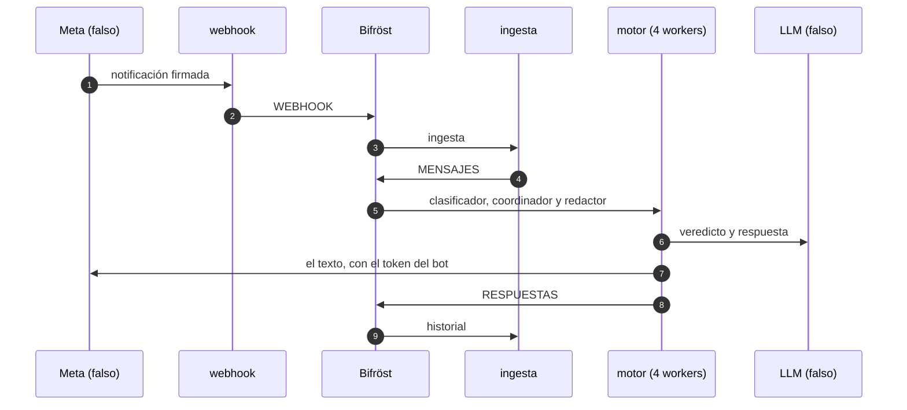

# Prueba de punta a punta: del webhook a la respuesta

* **Estado:** review
* **Fecha:** 2026-10-30
* **Decisores:** Jeremi Alcala
* **Fase AI-DLC:** 04-testing
* **Versión:** 1.0.0

Una persona escribe a un bot y recibe su respuesta, pasando por cada pieza de producción (HIG-135, Gate 3). Está en
`tests/e2e/` y corre en el workflow `e2e`: en cada PR a `main`, que son las releases, y a mano.



## Qué se levanta

`tests/e2e/compose.yaml`, como en midgard:
- **Las imágenes:** las del gateway y del motor, construidas del mismo commit.
- **Los servicios:** `hive-api`, `webhook` e `ingest`, y los cuatro workers del motor.
- **El modo de producción:** `ENVIRONMENT=production`, con TLS hacia Bifröst y Andvari, y los workers de solo lectura
  y sin capacidades.

Alrededor, lo que en producción es de fuera:

| Pieza | En la prueba | Igual que en producción |
|---|---|---|
| Bifröst | NATS 2.14.8 con `nats/bifrost.conf` y `jetstream/aprovisionar.sh` del repo `higerotech/bifrost` | Los usuarios, los permisos, los streams, los consumidores y los buckets |
| Andvari | OpenBao 2.7.1 con TLS, inicializado y abierto por la prueba | Transit `clientes`, las AppRoles `gateway`, `motor-claves`, `motor-coordinator` y `motor-notifier` y el KV `motor` |
| Atlas | MongoDB 7.0 | La base, sin réplicas |
| Hermod | RabbitMQ 4.3.5 | La cola `llm`, mientras la ingesta siga enviando el sobre viejo |
| Meta y el LLM | `tests/e2e/fakes.py`, que guarda lo que le pidieron | Las rutas y las respuestas de la Cloud API y de `/v1/chat/completions` |

## Cómo se prepara

Lo hace `tests/e2e/conftest.py`, en el orden en que lo haría un operador:

1. **Los secretos nacen en un directorio temporal:**
   - una CA y el certificado de NATS y OpenBao;
   - una contraseña hexadecimal por usuario de Bifröst, como las de su `instalar.sh`, porque NATS no acepta un `-`;
   - las claves del gateway y la del operador.
2. **OpenBao** se inicializa, se abre y se configura como Andvari.
3. **Bifröst** se aprovisiona con su propio script, dentro de nats-box.
4. **El gateway arranca.** Se registra la clave del operador (`ops.operator_key`), que da de alta un cliente. El
   cliente crea su bot, carga las credenciales y una regla, y `ops.engine_keys` le crea las claves del motor.
5. **El motor arranca,** y se comprueba que sus cuatro workers siguen vivos.

## Qué comprueba

`tests/e2e/test_del_webhook_a_la_respuesta.py`:

- **Una notificación firmada llega hasta la respuesta:**
  - Meta recibe el texto que escribió el LLM, desde el número del bot y con su token;
  - el LLM recibe una llamada del clasificador y una del redactor, con su clave;
  - el historial tiene el mensaje y la respuesta, con `inReplyTo`;
  - el bot queda en `ACT` (HIG-75).
- **Una notificación firmada con otro secreto da `403`,** y no llega nada a Meta.

## Cómo se corre

```sh
E2E=1 BIFROST_DIR=../bifrost pytest tests/e2e         # unos 30 s con las imágenes ya construidas
```

- **`E2E_KEEP=1`** deja el stack levantado para mirarlo.
- **`E2E_NO_BUILD=1`** no reconstruye las imágenes.
- **Sin `E2E=1`** la prueba se salta: el resto de la suite no tiene Docker.
- **Si una prueba falla,** su informe lleva el log de cada servicio.
- **`BIFROST_DIR`:** la copia de Bifröst tiene que tener sus ficheros con LF. En Windows, mejor con
  `git -c core.autocrlf=false archive`.

En el CI, la clave de despliegue `BIFROST_DEPLOY_KEY` lee el repo privado de Bifröst y nada más.

## Lo que encontró al montarla

Dos trampas del entorno, no fallos de Hive:
- Las contraseñas con `-` rompen la configuración de NATS.
- `tests/conftest.py` deja en el entorno el `GATEWAY_AUDIENCE` de las pruebas unitarias, y `docker compose` lo pasaba
  al motor. La prueba fija ahora el suyo.

## Lo que no cubre

- **La PWA:** su recorrido es HIG-141.
- **Messenger e Instagram:** llegan con el E10 del motor.
- **Lo que pase en Meta de verdad:** el falso solo sabe lo que dice su documentación.
