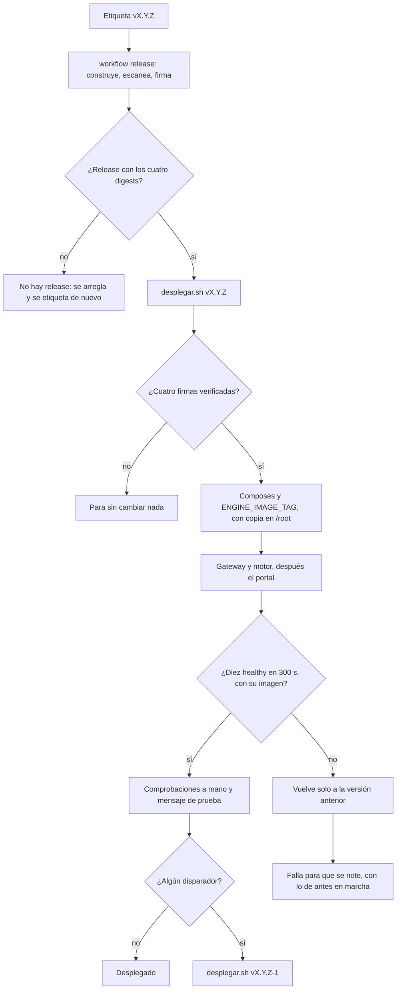

# Runbook: desplegar una release y volver atrás

* **Estado:** approved
* **Fecha:** 2026-11-06
* **Decisores:** Jeremi Alcala
* **Fase AI-DLC:** 05-deployment
* **Versión:** 1.1.0
* **Requisitos:** RF11 del [PRD](../01-requirements/mvp-baas-gateway.md); HIG-20 (Gate 4);
  [ADR-0036](../00-project/adr/0036-imagenes-firmadas-desde-el-ci.md)

Cómo se pone en producción una release de Hive y cómo se vuelve a la anterior. Producción es nidavellir
(192.168.10.2), y los proyectos viven en `/srv/apps/hive-gateway`, `/srv/apps/hive-engine` y `/srv/apps/hive-portal`.
Cómo se corta una release está en [releases](releases.md).

Desde HIG-20, ya no se construye nada en el servidor. Las imágenes son las que el workflow `release` construyó,
escaneó y firmó con la etiqueta. El servidor las descarga por su digest y solo las levanta si `cosign verify` dice
que las firmó ese workflow, de este repositorio, con esa misma etiqueta.



*Comportamiento, fase 05: el despliegue y sus dos caminos de vuelta.*

## Antes

Solo con el «despliega» de Jeremi en ese turno.

1. **El workflow `release` de la etiqueta acabó en verde,** y la release de GitHub tiene los cuatro
   `digest-hive-*.txt`. Si falló, no hay nada que desplegar.
2. **Si la release cambia Bifröst,** su `instalar.sh` va entre el gateway y el motor ([releases](releases.md)). Este
   script no toca Bifröst. En ese caso se despliega a mano en ese orden, o se instala Bifröst justo después del
   script; su vuelta atrás es la copia que deja en `/root/bifrost-antes-*`.
3. **Si cambia algo que no se deshace** (abajo), se decide antes cómo volver.
4. **Se verifica sin cambiar nada:**

   ```sh
   ssh -i ~/.ssh/id_ed25519_hgtech001 jalcala@192.168.10.2 'sudo bash -s -- vX.Y.Z --solo-verificar' < deploy/desplegar.sh
   ```

   Descarga las cuatro imágenes y comprueba sus firmas. Si una falla, se para aquí.

## Desplegar

```sh
ssh -i ~/.ssh/id_ed25519_hgtech001 jalcala@192.168.10.2 'sudo bash -s -- vX.Y.Z' < deploy/desplegar.sh
```

El script llega por la entrada estándar: no hay que copiar nada al servidor. Hace esto, y todo lo que puede fallar
va antes de cambiar nada:

1. **Dice qué corre** (la versión de `hive-api`) y cómo volver a ella.
2. **Verifica las cuatro imágenes:**
   - descarga el digest de cada una desde la release, con la forma exacta `hive-<imagen> ghcr.io/…@sha256:<64 hex>`;
   - descarga la imagen por ese digest, y no por su etiqueta;
   - pasa `cosign verify` con la identidad `release.yml@refs/tags/vX.Y.Z`.

   Si algo falla, termina con «No se ha cambiado nada».
3. **Descarga los tres composes** de la etiqueta.
4. **Comprueba que puede volver solo:** la versión anterior tiene que ser otra, y sus cuatro imágenes tienen que
   estar en el servidor.
5. **Cambia el servidor:**
   - etiqueta las imágenes como `vX.Y.Z`;
   - instala los composes que cambiaron, con copia en `/root/hive-<proyecto>-compose.bak-<ts>.yml`;
   - cambia `ENGINE_IMAGE_TAG` en el `.env` del motor, con copia en `/root/hive-engine.env.bak-<ts>`.
6. **Levanta el gateway y el motor seguidos,** porque desde DPoP un motor viejo frente a un gateway nuevo recibe 401.
   El portal va al final.
7. **Espera hasta 300 s** a que los diez contenedores estén `healthy` y corran justo la imagen verificada.

No imprime ningún `.env` y no toca el túnel, porque `hive-tunel` va en el perfil `tunel`.

**Si el paso 7 falla, vuelve solo** (RF11): reinstala las copias de este despliegue y levanta la versión anterior con
sus imágenes, que siguen en el servidor, sin descargar nada. Termina con error para que se note:

- «Ha vuelto a vX.Y.Z-1, que sí lo está»: producción está como antes. Hay que mirar el log de los contenedores
  que nombra.
- «…y la vuelta tampoco»: no está como antes. Se sigue a mano con [Volver a mano](#volver-a-mano).
- «No vuelve solo: …»: no podía volver solo, porque no se sabía qué corría, o ya era esa versión, o faltan sus
  imágenes. El mensaje dice qué comando lanzar.

## Comprobar

El script ya comprobó la salud y las imágenes. Después, a mano, durante unos 15 minutos:

- **Las URL públicas:** `https://hive-api.higerotech.com/health`, `https://hive-webhook.higerotech.com/health`,
  `https://hive-app.higerotech.com` y `https://hive.higerotech.com/docs/`, con la versión nueva en su HTML.
- **El caché del portal:** `curl -sI` de un módulo debe decir `no-cache`, y `cf-cache-status` nunca `HIT`.
- **Un mensaje de prueba:** Jeremi escribe al bot de prueba y llega la respuesta, con su traza completa en Saga
  ([medición de punta a punta](../04-testing/medicion-punta-a-punta.md)).
- **Los logs:** `sudo docker logs --since 15m <contenedor>`, sin `ERROR` ni `Traceback` nuevos.

## Disparadores de la vuelta atrás

Cualquiera de estos, en los primeros 15 minutos o cuando se vea, basta para volver sin investigar primero:

| Disparador | Cómo se ve |
|---|---|
| El script no deja los diez healthy | Vuelve solo, y falla con «Ha vuelto a…» |
| Un contenedor se reinicia | `RestartCount` mayor que 0, o un aviso del vigía o de Thor |
| Errores nuevos en el log | `ERROR` o `Traceback` en el gateway o el motor que la versión anterior no daba |
| El mensaje de prueba no tiene respuesta | Sin respuesta en 60 s, o la traza Saga cortada |
| 401 entre el motor y el gateway | `401` en el log del motor: DPoP desparejado |
| Una URL pública falla | `/health` distinto de 200, o el portal que no carga |
| Se incumple el SLO de RNF10 | Mediana de más de 10 s o p95 de más de 20 s en las respuestas, con el LLM caliente |

**No es un disparador:** unos 30 s de errores de conexión en `hive-ingest` si se reinició Bifröst, porque se
reconecta solo.

## Volver atrás

Volver es desplegar la versión anterior con el mismo script:

```sh
ssh -i ~/.ssh/id_ed25519_hgtech001 jalcala@192.168.10.2 'sudo bash -s -- vX.Y.Z-1' < deploy/desplegar.sh
```

- **Desde la 0.20.0,** las versiones están firmadas en ghcr, y la vuelta se verifica igual que la ida.
- **Las anteriores a la 0.20.0** no están firmadas. Se vuelve a ellas con `--local`, que usa las imágenes que siguen
  en el servidor sin verificarlas. El script lo dice al empezar: «Para volver: …».
- **Los composes** se descargan siempre de la etiqueta de la versión a la que se va.

### Volver a mano

Si GitHub no responde, o el script no puede, se vuelve con lo que hay en el servidor:

1. Se reinstalan las copias de `/root` del despliegue que se deshace (`hive-*-compose.bak-<ts>.yml` y
   `hive-engine.env.bak-<ts>`), con `install -m 0644` para los composes y `cp -p` para el `.env`.
2. `cd /srv/apps/hive-gateway && sudo env IMAGE_TAG=vX.Y.Z-1 docker compose up -d`
3. `sudo docker compose --project-directory /srv/apps/hive-engine up -d`, que toma la etiqueta del `.env`.
4. `cd /srv/apps/hive-portal && sudo env PORTAL_IMAGE_TAG=vX.Y.Z-1 docker compose up -d`

## Lo que no se deshace

Volver a la imagen anterior no deshace lo que la versión nueva ya hizo fuera de sus contenedores:

- **Lo que guardó en MongoDB** con una forma nueva: la versión anterior tiene que poder leerlo. Una release que
  cambia la forma de lo que guarda lo dice en su CHANGELOG, y su vuelta se decide antes de desplegarla.
- **Los cambios de Bifröst,** como streams, consumidores, usuarios o buckets: se revierten aparte, con su copia.
- **Lo que ya salió:** los mensajes enviados a Meta, los avisos de los webhooks salientes y las plantillas creadas.
- **Las claves rotadas** en Andvari o en el IdP.

## Prueba de la vuelta atrás

Hecha el 2026-11-06, en nidavellir y con el «despliega» de Jeremi, en dos tiempos y con un mensaje de prueba en
cada uno. Las horas son UTC.

| Tiempo | Qué | Duración | Resultado |
|---|---|---|---|
| 1 (01:37) | De la v0.20.0, construida en el servidor, a la v0.19.0 con `--local` | 42 s | Los diez contenedores, healthy y sin reinicios. El script instaló el compose del gateway de la 0.19.0, que aún no era de solo lectura, con copia del anterior |
| Mensaje | Respuesta del bot con la v0.19.0 (01:58) | 17,7 s | Traza completa en Saga, del webhook a `ingest.answer`. Era el primero tras recrear los contenedores; el siguiente tardó 7,3 s |
| 2 (02:00) | De la v0.19.0 a la v0.20.0 firmada, desde ghcr | 96 s, con las descargas | Las cuatro firmas, verificadas antes de cambiar nada. Los diez contenedores, healthy, de solo lectura y con el digest de la release |
| Mensaje | Respuesta del bot con la v0.20.0 (02:41) | 9,4 s | Traza completa en Saga |

En los dos tiempos, las cuatro URL públicas respondieron 200 y la documentación mostraba la versión desplegada. Los
logs, sin `ERROR`, `Traceback` ni `401`. El túnel no se tocó. **Desde las 02:01, producción corre lo que firmó el CI:**
el gateway `sha256:707e7a41…`, el motor `sha256:b0160dc2…`, el portal `sha256:0b5e2f98…` y la documentación
`sha256:b7644f37…`.

La vuelta automática, la de cuando la sonda falla, no se provocó en producción. La prueban
`tests/unit/test_desplegar.py`, con la sonda rota a propósito, y el mismo camino de `levantar` y `esperar` que los dos
tiempos usaron.
