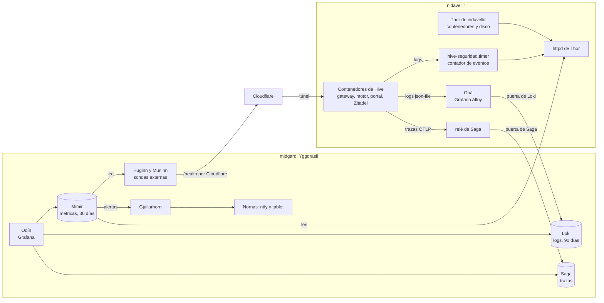
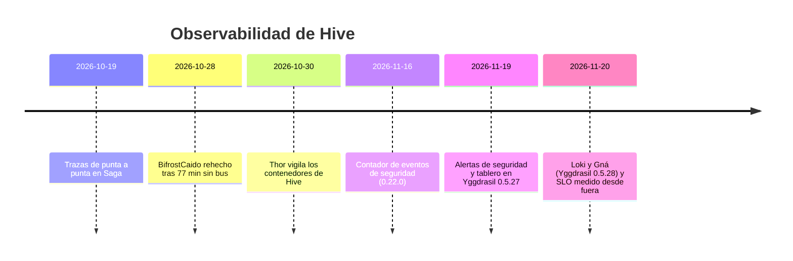

# 06 — Monitoreo (Gate 5)

* **Estado:** review
* **Fecha:** 2026-11-20
* **Decisores:** Jeremi Alcala
* **Fase AI-DLC:** 06-monitoring
* **Versión:** 1.0.0
* **Requisitos:** A09 de la [matriz OWASP](../../.ai-dlc/owasp-mapping.md); HIG-140 (Gate 5)

Cómo se sabe qué le pasa a Hive en producción, quién avisa y qué se hace entonces. Hive no tiene su propio sistema
de observabilidad: lo pone Yggdrasil, en midgard. Hive escribe logs y trazas, y Yggdrasil los guarda, los mide y
avisa.

| Documento | Qué cuenta |
|---|---|
| [SLI y SLO](slo.md) | Qué se promete de disponibilidad y latencia, cómo se mide y qué pasa si se gasta el presupuesto |
| [Alertas y tableros](alertas-y-tableros.md) | Qué avisa de Hive, por dónde llega el aviso y qué tableros hay en Odín |
| [Eventos de seguridad](eventos-de-seguridad.md) | El contador que convierte en métricas los eventos de seguridad de los logs |
| [Runbook de incidentes](runbook-incidentes.md) | Qué se hace con una clave robada, un token de Meta filtrado, un cliente comprometido o una caída |
| [Feedback loop](feedback-loop.md) | Cómo vuelve lo que se aprende en producción a los requisitos, el diseño y las pruebas |

Cierra con el [Gate 5](../../.ai-dlc/gates/gate-5-monitoring.md).

## Los tres pilares

*Estructura y comportamiento, fase 06: de dónde sale cada pilar y dónde se consulta.*

| Pilar | Qué escribe Hive | Dónde se guarda | Cómo se consulta |
|---|---|---|---|
| **Métricas** | Nada en la aplicación: salen de sus logs (el contador de [eventos de seguridad](eventos-de-seguridad.md)), de la salud de sus contenedores (Thor) y de sondas desde fuera ([SLO](slo.md)) | Mimir, en midgard, 30 días | Odín: «Hive · seguridad» y «Hive · SLO» |
| **Logs** | Solo `WARNING` y más, sin datos personales (RS19). Los `WARNING` de auditoría dicen quién hizo qué | Loki, en midgard, 90 días, sin borrado por API. Gná los lleva desde nidavellir (ADR-0013 de Yggdrasil) | Odín, Explore con el datasource Loki: `{host="nidavellir", contenedor="hive-api"}` |
| **Trazas** | Una traza por mensaje, de la entrada del webhook a la respuesta, sin datos personales ([trazas](../03-implementation/trazas.md)) | Saga (Tempo), en midgard | Odín, Explore con el datasource Saga |

Además, la **auditoría de cada cliente** queda en MongoDB 12 meses (`GET /audit`, RF18). No es un pilar de
observabilidad, pero en un incidente dice qué hizo cada actor de ese cliente.

**Lo que no hay:**
- **Los logs no llevan el id de traza,** así que de una línea de log no se salta a su traza. Se cruzan por la hora y
  el bot.
- **Hive no expone métricas propias** (latencia por ruta, errores por código). Con unas 60 peticiones por semana no
  darían una señal fiable; las sondas sí la dan. Se revisa cuando haya clientes externos ([feedback loop](feedback-loop.md)).

## Cómo se llegó aquí

*Trazabilidad, fase 06: los hitos del pilar de observabilidad.*
