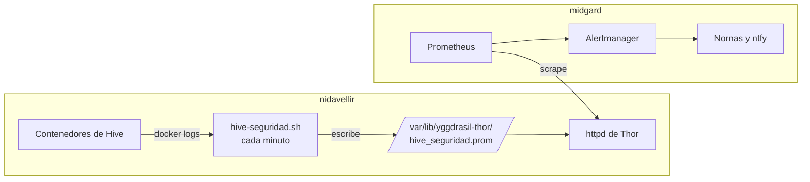

# Eventos de seguridad: el contador de los logs

* **Estado:** review
* **Fecha:** 2026-11-16
* **Decisores:** Jeremi Alcala
* **Fase AI-DLC:** 06-monitoring
* **Versión:** 1.0.0
* **Requisitos:** A09 de la [matriz OWASP](../../.ai-dlc/owasp-mapping.md); HIG-140 (Gate 5)

Cómo llegan a Prometheus los eventos de seguridad de Hive, para que las reglas de Yggdrasil avisen de ellos.

**Decisión de Jeremi del 2026-11-16:** se cuentan en los logs, que ya los escriben sin datos personales, y no con
métricas dentro de la aplicación. Así no hay que abrir un puerto por contenedor hacia midgard ni contar en los dos
procesos del webhook. A cambio, el contador depende del texto de los logs, y por eso una prueba fija cada expresión
contra el código.



*Comportamiento, fase 06: del log a la alerta.*

## Qué cuenta

`deploy/seguridad/hive-seguridad.sh` lo lanza `hive-seguridad.timer` cada minuto, en el segundo 5. Cada pasada lee
de cada contenedor lo que escribió desde el final de la anterior (`docker logs --since --until`). Después suma a sus
contadores las líneas que casan con cada evento:

| Evento | Contenedores | Qué es | Por qué importa |
|---|---|---|---|
| `token_rechazado` | `hive-api` | `/oauth/token` rechaza una aserción o un intercambio | Muchos seguidos: alguien prueba claves o aserciones robadas o caducadas |
| `token_frenado` | `hive-api` | `/oauth/token` frena un origen o una clave por su límite | Fuerza bruta, o un cliente con un bucle |
| `ruta_denegada` | `hive-api` | Un rol pide una ruta que no le toca | Un analista, el motor o un cliente fuera de su matriz de roles |
| `firma_webhook` | `hive-webhook` | Un aviso sin firma de Meta o con una firma mala | Alguien que no es Meta llama al webhook |
| `verificacion_webhook` | `hive-webhook` | La verificación del webhook con un `verifyToken` equivocado | Alguien intenta suscribir el webhook |
| `bot_err` | gateway | Meta rechaza el token de un bot, que pasa a ERR | Token caducado, revocado o filtrado y anulado |
| `andvari` | gateway | Andvari no responde, y la ruta da 503 | Sin claves no se cifra ni se descifra nada |
| `bifrost` | gateway y motor | Bifröst no acepta o no entrega, o el motor lo espera | Los mensajes no avanzan |
| `mongodb` | gateway | La base no responde, y el webhook da 503 | Meta reintenta; si dura, se pierden avisos |

Los contadores de `hive-docs` y `hive-portal` no se leen: no escriben ninguno de estos eventos.

## Las métricas

El fichero `/var/lib/yggdrasil-thor/hive_seguridad.prom` lo sirve el httpd de Thor, como el del respaldo de Zitadel:

- **`hive_seguridad_eventos_total{evento, contenedor}`**, contador. Solo crece, y sale a 0 aunque no haya pasado
  nada, para que `increase()` tenga de dónde partir. Si se pierde el estado (`/var/lib/hive-seguridad`), vuelve a
  cero, y Prometheus lo trata como un reinicio.
- **`hive_seguridad_contenedor_leido{contenedor}`**, 1 o 0. Con 0, lo que el contenedor escribió en esa ventana no
  se contó.
- **`hive_seguridad_ultima_pasada_segundos`**: si deja de avanzar, el contador está parado.

No copia el texto de ninguna línea, ni al fichero ni al journal: solo cuántas casan.

## La prueba de contrato

`tests/unit/test_hive_seguridad.py` tiene un mensaje de ejemplo por cada fila del contador, y comprueba tres cosas:

1. que cada ejemplo lo escribe un log del código, porque recorre todas las llamadas a `log.*` de `src/`, `shared/` y
   `engine/src/`;
2. que cada ejemplo lo cuenta su evento y ningún otro, y que lo habitual en producción no se cuenta;
3. que cada fila casa con algún ejemplo.

Si alguien cambia el texto de uno de estos logs, la prueba falla en el PR. Sin ella, el contador dejaría de contarlo
sin avisar. Las pruebas de conteo corren con un docker de mentira, en Linux.

**Para añadir un evento:**

1. una fila en `EVENTOS` del script;
2. un ejemplo en `EJEMPLOS` de la prueba;
3. su alerta en `deploy/prometheus/rules/hive-alertas.yml` de Yggdrasil, con su test de promtool.

## Instalar en nidavellir

Como root, desde el repositorio:

```sh
ssh nidavellir 'sudo install -m 0755 /dev/stdin /usr/local/sbin/hive-seguridad.sh' < deploy/seguridad/hive-seguridad.sh
ssh nidavellir 'sudo install -m 0644 /dev/stdin /etc/systemd/system/hive-seguridad.service' < deploy/seguridad/hive-seguridad.service
ssh nidavellir 'sudo install -m 0644 /dev/stdin /etc/systemd/system/hive-seguridad.timer' < deploy/seguridad/hive-seguridad.timer
ssh nidavellir 'sudo systemctl daemon-reload && sudo systemctl enable --now hive-seguridad.timer'
```

Para comprobarlo, `systemctl list-timers hive-seguridad.timer` y `cat /var/lib/yggdrasil-thor/hive_seguridad.prom`.
Si falla, el motivo está en `journalctl -u hive-seguridad`.

**La prueba del 2026-11-16,** antes de instalarlo: una pasada sobre las últimas 48 h, con el estado y las métricas en
un directorio temporal. Leyó los ocho contenedores en 0,23 s y contó 4 rechazos de `/oauth/token`. Lo demás, a
cero.
