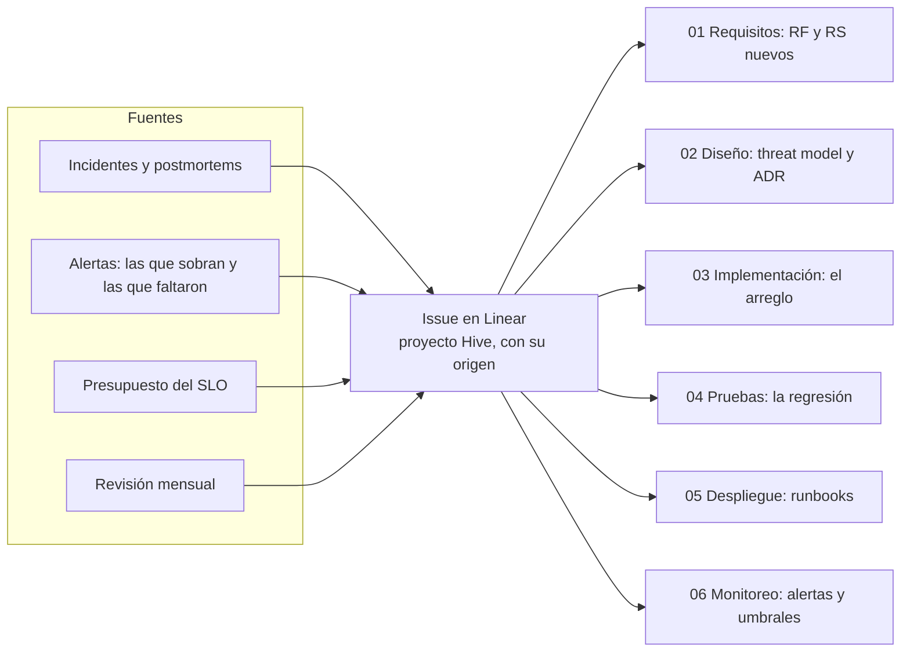

# Feedback loop: de producción a las fases anteriores

* **Estado:** review
* **Fecha:** 2026-11-20
* **Decisores:** Jeremi Alcala
* **Fase AI-DLC:** 06-monitoring
* **Versión:** 1.0.0
* **Requisitos:** HIG-140 (Gate 5)

Lo que se aprende en producción vuelve como un cambio en una fase anterior: un requisito, el threat model, una
prueba, una alerta o un runbook. Si no cambia nada, no se ha aprendido.

*Trazabilidad, fase 06: de dónde sale cada cambio y a qué fase vuelve.*

## Cómo funciona

- **Cada acción de un postmortem es una issue** del proyecto Hive en Linear, con su origen («Origen: incidente
  AAAA-MM-DD», «Origen: alerta X») y la fase a la que vuelve. Se cierra cuando cambia el documento de esa fase. Desde el
  2026-11-05, el plan de Linear no deja crear issues nuevas; mientras siga así, la acción se anota en la tabla de
  [pendientes](#pendientes) de este documento.
- **Un fallo que se escapó lleva su prueba de regresión** (fase 04) antes del arreglo, como cualquier cambio de Hive.
- **Una alerta que no hizo falta** (avisó sin incidente) se ajusta con datos: su umbral se mueve con lo medido, y su
  prueba de promtool con él. **Un incidente que no avisó** pide una alerta nueva, con su prueba.
- **Una amenaza nueva o mal valorada** va al threat model de la fase 02, con su control.

**La revisión mensual** (el primer día laborable del mes, unos 30 min):
1. «Hive · SLO»: el presupuesto gastado y por qué. Si se agotó, se aplica la [política](slo.md#política-del-presupuesto).
2. «Hive · seguridad»: los eventos del mes. Se comprueba que cada pico tiene explicación y que los umbrales siguen
   teniendo sentido.
3. Las alertas que dispararon: cuáles llevaron a hacer algo y cuáles no.
4. Los pendientes de este documento.

## Lo que ya volvió

El ciclo no es nuevo: esto ya salió de producción y cambió una fase anterior.

| Fecha | Qué pasó | A qué fase volvió |
|---|---|---|
| 2026-10-21 | La API de gestión pasó seis minutos colgada, y Docker no la reinició porque el proceso no terminaba | 05: el vigía de Hive (`deploy/vigia/`), que reinicia lo que está unhealthy |
| 2026-10-28 | Bifröst pasó 77 min reiniciándose, y el aviso llegó 33 min tarde | 06: `BifrostCaido` mira la peor muestra de cada ventana, con su prueba del bucle |
| 2026-11-16 | 48 h de logs de producción: 4 rechazos de token y ningún otro evento | 06: los umbrales de las alertas de seguridad salen de esa medida |
| 2026-11-19 | Un cambio de compose de Yggdrasil no se aplicó con la release que lo traía | 05 de Yggdrasil: el despliegue a mano tras la release, en su README |
| 2026-11-20 | La primera lectura de Gná llevó a Loki líneas de más de 7 días, que Loki descartó | 06: anotado en la ADR-0013 de Yggdrasil y en HIG-140 |
| 2026-11-20 | Al escribir el runbook: la ruta que revoca una clave y la baja de un cliente decían que los tokens emitidos dejan de valer al instante, y valen hasta 10 min | 02 y 03: corregidas la descripción de `DELETE /clients/{client_id}/keys/{kid}` (y el contrato OpenAPI) y [exportar y borrar](../03-implementation/exportar-y-borrar.md) |

## Pendientes

### De este runbook

Los [huecos conocidos](runbook-incidentes.md#huecos-conocidos) del runbook de incidentes, con la fase a la que vuelven:

| Hueco | Fase | Qué haría falta |
|---|---|---|
| Sin lista de revocados: un token vale 10 min tras quitar su clave | 02 | Una ADR: lista de revocados por `jti` en Bifröst, o un tiempo de vida más corto, frente al coste de consultar en cada petición |
| Un cliente no se puede suspender | 01 y 03 | Un requisito y su ruta de operador. Que suspenda también sus tokens depende de la fila anterior |
| Un bot no se puede pausar, y ERR es solo informativo | 01 y 03 | Que el webhook y el motor respeten un estado de bot bloqueado |
| La carga de credenciales de un bot es `INFO` | 03 y 06 | Un `WARNING` de auditoría, y su frase en la prueba de contrato del contador |
| Las acciones del operador no van a la auditoría del cliente | 01 | RF20, la auditoría de la plataforma (HIG-109) |
| Sin procedimiento para Zitadel, Bifröst, Hermod ni la clave de un worker | 05 | Sus procedimientos, en `deploy/idp` y en los repos de Bifröst y de Hermod |
| Los respaldos guardan la clave de datos envuelta | 02 | Decidido en la ADR-0014 (caducan a los 365 días). Se revisa con el primer cliente externo |

### Del monitoreo

- **SLI por petición** (5xx y latencia de `/oauth/token` y del webhook) cuando haya clientes externos ([SLO](slo.md#cuándo-se-revisa)).
- **El id de traza en los logs,** para saltar de una línea de Loki a su traza en Saga.
