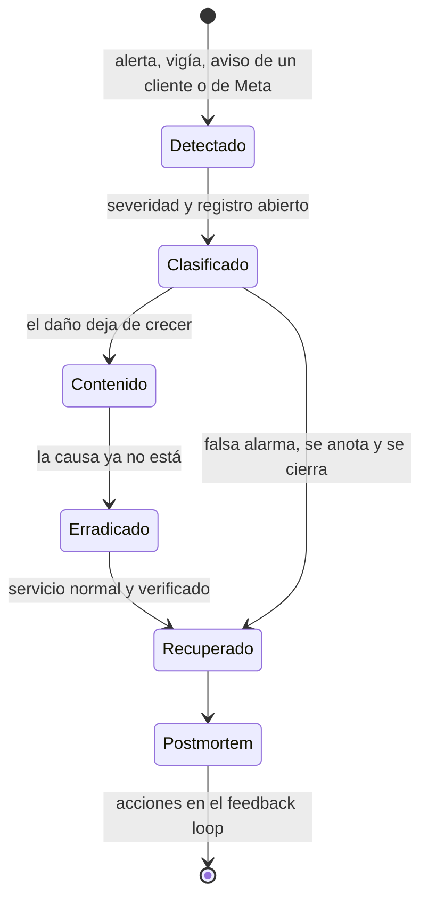

# Runbook de incidentes

* **Estado:** review
* **Fecha:** 2026-11-20
* **Decisores:** Jeremi Alcala
* **Fase AI-DLC:** 06-monitoring
* **Versión:** 1.0.0
* **Requisitos:** A09 de la [matriz OWASP](../../.ai-dlc/owasp-mapping.md); HIG-140 (Gate 5); art. 33.2 del GDPR
  ([clasificación de datos](../00-project/data-classification.md))

Qué se hace cuando algo va mal en Hive: una clave robada, un token de Meta filtrado, un cliente comprometido o
una caída. Hive tiene un solo operador, Jeremi, que hace de responsable del incidente, de quien lo ejecuta y de
quien escribe el registro. Hoy no hay clientes externos: lo que toca a clientes queda listo para el primero.

Este runbook dice **qué hacer y en qué orden**. Los detalles de cada mecanismo están en su documento, que se enlaza
y no se copia.



*Comportamiento, fase 06: el ciclo de vida de un incidente.*

## 1. Detectar

Por dónde llega casi todo: las alertas de [alertas y tableros](alertas-y-tableros.md), por ntfy y en Hlidskjalf.
También pueden llegar por un cliente que avisa, por Meta (un aviso de token o de app comprometida), por GitHub (un
secreto en un PR que gitleaks detecta) o por una revisión que encuentra algo raro.

| Alerta | Escenario que abre |
|---|---|
| `HiveTokenRechazosRepetidos`, `HiveTokenFrenado` | [A](#a-la-clave-de-firma-de-un-cliente-robada), si los rechazos son de un cliente concreto; si son muchos orígenes, es un intento de entrar y se vigila |
| `HiveRutasDenegadas` | [A](#a-la-clave-de-firma-de-un-cliente-robada) o [D](#d-la-cuenta-de-una-persona-comprometida): alguien prueba lo que su rol no le deja |
| `HiveWebhookRechazado` | [B](#b-el-token-de-meta-de-un-bot-filtrado), si alguien conoce la URL y el `verifyToken` de un bot |
| `HiveBotEnError` | [B](#b-el-token-de-meta-de-un-bot-filtrado): Meta anuló el token, quizá porque se filtró |
| `HiveSLOQuemaRapida`, `HiveDependenciaFallando`, `BifrostCaido`, `AndvariSellado`, `ServicioDeHostCaido` | [F](#f-hive-caído-o-degradado) |

## 2. Clasificar y abrir el registro

| Severidad | Cuándo | Ritmo |
|---|---|---|
| **SEV1** | Datos de clientes expuestos o en riesgo cierto (credencial usada por otro, acceso indebido comprobado), o Hive caído del todo | Ahora. Se contiene antes de investigar |
| **SEV2** | Una credencial expuesta sin indicios de uso, o Hive degradado (un componente, fallos intermitentes) | En el día |
| **SEV3** | Un intento sin éxito, un fallo sin impacto, o una falsa alarma que hay que entender | En la semana |

**El registro se abre al clasificar,** en `docs/06-monitoring/incidentes/AAAA-MM-DD-<tema>.md`, con la plantilla del
[postmortem](#5-postmortem). Se escribe sobre la marcha, con horas en UTC: qué se vio, qué se hizo y qué pasó. Sin
datos personales ni secretos, solo identificadores (`client_id`, `bot_id`, `kid`).

## 3. Contener

Primero se corta lo que el atacante puede seguir haciendo. Después se investiga. Lo que cada escenario **no** puede
hacer hoy está en [huecos conocidos](#huecos-conocidos).

### A. La clave de firma de un cliente, robada

Con ella se piden tokens de acceso en `/oauth/token` (aserción `private_key_jwt` y prueba DPoP).

1. **Quitar todas las claves que el cliente no reconozca,** no solo la robada. Quien la tenía pudo añadir una suya
   y quitar la legítima. `GET /clients` las lista y `DELETE /clients/{client_id}/keys/{kid}` las quita, como
   operador ([revocar y recuperar](../03-implementation/autenticacion.md#revocar-y-recuperar)). Desde ese momento
   no sale ningún token nuevo con ellas.
2. **Los tokens ya emitidos siguen valiendo hasta 10 minutos:** la API los valida sin consultar la base, y no hay
   lista de revocados. Si hay indicios de uso (SEV1), se cortan todos los de la plataforma rotando la clave de firma
   del gateway sin esperar ([rotar el par de firma](../03-implementation/autenticacion.md#rotar-el-par-de-firma-del-gateway)).
   Afecta a todos los clientes, al motor y al portal, que piden otro con su aserción.
3. **El cliente registra una clave nueva:** `POST /clients/{client_id}/keys` (el operador) o `POST /keys` (el
   cliente, con su prueba).

**Evidencia:** cada alta y cada baja de clave deja un `WARNING` en `hive-api`. Los rechazos dicen el motivo. Ver
[buscar la evidencia](#buscar-la-evidencia).

### B. El token de Meta de un bot, filtrado

Los tokens de Meta, el `appSecret` y el `verifyToken` de cada bot se guardan cifrados con la clave de datos del
cliente. Que se filtren supone otra vía: un log, un `.env` o un equipo del cliente.

1. **Revocar el token en Meta** (Business Manager o la consola de la app). Hive no puede hacerlo por el cliente, y es
   lo único que corta el uso del token robado.
2. **Cargar el nuevo:** `PUT /chat/{bot_id}/credentials`, como administrador del cliente o con su credencial de
   máquina; el analista no puede. Solo cambia lo que se envía, y si el bot estaba en ERR vuelve a ACT. El webhook
   puede usar el anterior hasta 30 s, y el notifier del motor hasta 10 min, o hasta que Meta lo rechace: entonces lo
   pide otra vez.
3. **Si se filtró el `appSecret`,** se rota en Meta y se carga con la misma ruta. Sin él, cualquiera puede firmar
   avisos falsos al webhook de ese bot.
4. **Si se filtró el `verifyToken`:** `POST /chat/{bot_id}/verify-token`. El anterior deja de valer al instante, y las
   suscripciones de Meta siguen recibiendo.

**Evidencia:** la rotación del `verifyToken` deja un `WARNING`. La carga de credenciales solo queda en la auditoría
del cliente (`GET /audit`, categoría `keys`), no en los logs.

### C. Un cliente comprometido

Alguien controla las credenciales o el sistema de un cliente.

1. **Dejarlo sin acceso:** quitarle todas las claves de firma ([A](#a-la-clave-de-firma-de-un-cliente-robada),
   paso 1) y bloquear a sus personas (`PUT /people/{person_id}` con `{"status": "blocked"}`). Un cliente no se puede
   suspender por la API.
2. **Sus bots siguen respondiendo** a sus usuarios con lo que tengan configurado. Si hay que pararlos, la única vía
   es `DELETE /bot/{bot_id}`, que es irreversible. Antes, revocar sus tokens en Meta ([B](#b-el-token-de-meta-de-un-bot-filtrado))
   para el bot sin borrar nada.
3. **Si el cliente pide la baja,** o la decide el operador: `DELETE /clients/{client_id}`
   ([la baja de un cliente](../03-implementation/exportar-y-borrar.md#la-baja-de-un-cliente-paso-a-paso)). Borra sus
   bots y sus datos, y su clave de datos. No se deshace.
4. **Avisar al cliente** ([aviso de brechas](#aviso-de-brechas)).

### D. La cuenta de una persona, comprometida

Una persona del portal de un cliente (`hive-portal`, con Zitadel).

1. **En Hive:** `PUT /people/{person_id}` con `{"status": "blocked"}`, o `DELETE /people/{person_id}`, como
   administrador de ese cliente. Su próximo intercambio de token falla: pierde el acceso en 10 min como mucho.
2. **En el portal:** su sesión termina en el siguiente intercambio. Para cerrar **todas** las sesiones del portal a la
   vez, se rota la clave de las sesiones ([el portal](../03-implementation/autenticacion.md#el-portal-hive-portal)).
3. **En Zitadel:** desactivar a la persona y cerrar sus sesiones desde la consola. No hay un procedimiento probado en el
   repo: es un [hueco](#huecos-conocidos).

**Evidencia:** `A session began` y `The session of person … ended` en `hive-portal`, y los `Audit:` de personas en
`hive-api`.

### E. Un secreto de la plataforma

| Secreto | Cómo se rota | Dónde está |
|---|---|---|
| Clave de firma del gateway | Generar una nueva y quitar la antigua; corta todos los tokens | [Rotar el par de firma](../03-implementation/autenticacion.md#rotar-el-par-de-firma-del-gateway) |
| Clave de cifrado del gateway | Por pasos, sin cortar a nadie | [Rotar el par de cifrado](../03-implementation/autenticacion.md#rotar-el-par-de-cifrado-del-gateway) |
| `secret-id` de Andvari del gateway | Cambiar `keys/andvari-secret-id`; se relee en cada login, sin reiniciar | [Cifrado de datos](../03-implementation/cifrado-de-datos.md) |
| Credenciales de Andvari de los workers del motor | Emitir otras con `raiz-temporal.sh` desde el repo de Andvari | [Despliegue del motor](../../engine/docs/05-deployment/README.md) |
| Clave de un worker para un cliente | `DELETE /clients/{client_id}/service-keys/{kid}`; vale al instante | [Dar paso al motor](../03-implementation/autenticacion.md#dar-paso-al-motor-de-respuestas) |
| Token de la cuenta de servicio de Zitadel | Cambiar el fichero; se relee sin reiniciar | [Autenticación](../03-implementation/autenticacion.md) |
| Secreto OIDC y clave de sesiones del portal | Regenerar en Zitadel / rotar el fichero | [El portal](../03-implementation/autenticacion.md#el-portal-hive-portal) |
| Usuarios de Bifröst y de Hermod | Sin procedimiento escrito: un [hueco](#huecos-conocidos) | Repos de Bifröst y de Hermod |

Un secreto que llega a un repositorio público se da por filtrado aunque se borre el commit: se rota.

### F. Hive caído o degradado

1. **¿Es Hive o es la casa?** Si también están `HogarSinRuta` o las alertas de las WAN, el problema es la salida de
   midgard, y las sondas del SLO no cuentan ese rato. Si salta `ThorSinMetricas` de nidavellir, el host está colgado
   o apagado ([arranque tras un apagón](../05-deployment/arranque-tras-apagon.md)).
2. **¿Una dependencia?** `AndvariSellado`, `BifrostCaido` o `HiveDependenciaFallando` dicen cuál. Andvari sellado se
   abre con las claves de la bóveda de Jeremi.
3. **¿Una release?** Si empezó con un despliegue, se vuelve a la versión anterior
   ([despliegue y vuelta atrás](../05-deployment/runbook-despliegue-y-rollback.md)).
4. **¿Un contenedor?** El vigía ya reinicia lo que Docker marca unhealthy. Si no basta, `docker logs` en nidavellir
   o Loki.

El tablero «Hive · SLO» dice desde cuándo y cuánto presupuesto se ha gastado.

## Buscar la evidencia

En Odín, Explore con el datasource **Loki** (90 días de logs). Algunas consultas útiles:

| Qué | LogQL |
|---|---|
| Altas y bajas de claves de clientes y workers | `{host="nidavellir", contenedor="hive-api"} \|~ "(Signing\|Service) key .*(added to\|removed from) client"` |
| Rechazos y frenos de `/oauth/token` | `{contenedor="hive-api"} \|~ "(Rejected\|Turned away) a request for an access token"` |
| Bots que cambian de estado | `{host="nidavellir"} \|= "Chatbot " \|= " is now "` |
| Avisos falsos al webhook | `{contenedor="hive-webhook"} \|= "Rejected webhook"` |
| Acciones auditadas de personas y operadores | `{host="nidavellir"} \|= "Audit: "` |
| Sesiones del portal | `{contenedor="hive-portal"} \|~ "A session began\|The session of person"` |
| Bajas de clientes y de bots | `{contenedor="hive-api"} \|~ "Client deleted\|deleted chatbot"` |
| Accesos a Andvari (audit de OpenBao) | `{contenedor="andvari-openbao"}` |

- **La auditoría del cliente:** `GET /audit`, 12 meses. Las acciones del operador quedan en la auditoría del
  operador, no en la del cliente afectado.
- **Las trazas en Saga:** por la hora y el bot. Los logs no llevan el id de traza.
- **Antes de tocar nada en un SEV1:** si la evidencia está solo en el host (un `docker logs` de más de 90 días, un
  fichero), se copia a midgard. Loki no permite borrar por API, así que lo que ya está allí no se pierde.

## 4. Erradicar y recuperar

- **Erradicar:** quitar lo que permitió el incidente. Una clave que se guardaba mal, un secreto en un repo, un
  equipo comprometido del cliente o un fallo de Hive (con su PR, su prueba y su release).
- **Recuperar:** el servicio vuelve a lo normal y se comprueba:
  - las alertas resueltas;
  - el tablero «Hive · SLO» en verde;
  - un mensaje de prueba respondido de punta a punta;
  - el cliente opera con sus credenciales nuevas.
- **Vigilar** las 24 h siguientes el mismo patrón en Loki y en «Hive · seguridad».

## Aviso de brechas

Hive es el encargado del tratamiento de los datos de sus clientes (art. 4.8 del GDPR). Si un incidente afecta a
datos personales de un cliente, el art. 33.2 obliga a **avisarle sin dilación indebida** desde que se sabe. La
notificación a la autoridad (72 h, art. 33.1) y a los afectados (art. 34) la hace el cliente, como responsable.

El aviso, por escrito al contacto del cliente, dice lo que se sepa en ese momento y se completa después
(art. 33.3 y 33.4):
- qué pasó y cuándo, y qué datos y cuántos registros afecta, aproximadamente;
- las consecuencias probables;
- lo que Hive ya hizo y lo que el cliente debe hacer (rotar su clave, revocar su token en Meta);
- quién atiende, que es Jeremi.

Se guarda copia en el registro del incidente. El contacto y el canal de aviso de cada cliente se fijan en su
contrato de encargo, que es un entregable anterior al primer cliente externo.

## 5. Postmortem

Para todo SEV1 y SEV2, en los 5 días siguientes, en el mismo fichero del registro, **sin culpables**: se busca qué
dejó pasar el fallo, no quién.

```markdown
# Incidente AAAA-MM-DD: <tema>

* **Severidad:** SEV1 | SEV2 | SEV3
* **Detectado:** <hora UTC y por dónde>   **Contenido:** <hora>   **Recuperado:** <hora>
* **Impacto:** <qué clientes, qué datos, cuánto presupuesto del SLO>

## Cronología
## Causa
## Qué funcionó y qué no
## Acciones
| Acción | Fase a la que vuelve | Issue |
```

Las acciones entran en el [feedback loop](feedback-loop.md): cada una es una issue, y la fase a la que vuelve dice
qué documento cambia (el threat model, una prueba, una alerta, este runbook).

## Huecos conocidos

Lo que hoy no se puede hacer, encontrado al escribir este runbook. Están en el [feedback loop](feedback-loop.md#de-este-runbook).

1. **No hay lista de revocados:** un token de acceso vale hasta que caduca (10 min) aunque se quite su clave o se borre
   el cliente. El único corte inmediato es rotar la clave de firma del gateway, que afecta a todos.
2. **Un cliente no se puede suspender por la API:** solo dejarlo sin claves, o borrarlo.
3. **Un bot no se puede pausar:** el estado ERR es informativo, y ni el webhook ni el motor lo miran. La única forma de
   pararlo es borrarlo, o revocar su token en Meta.
4. **La carga de credenciales de un bot no queda en los logs** de producción (es `INFO`): solo en la auditoría del
   cliente.
5. **Las acciones del operador sobre un cliente** quedan en la auditoría del operador, no en la del cliente. La
   auditoría de la plataforma (RF20, HIG-109) está pendiente.
6. **Sin procedimiento escrito** para cerrar las sesiones de una persona en Zitadel, ni para rotar las credenciales de
   Bifröst y de Hermod, ni la clave de un worker del motor.
7. **Los respaldos guardan la clave de datos envuelta:** borrar un cliente no borra sus datos de los respaldos hasta
   que caducan, a los 365 días (ADR-0014).

## El simulacro

El proceso se prueba con un simulacro real sobre el cliente de prueba (decisión de Jeremi del 2026-11-16; HIG-140,
punto 5). Su resultado se anota aquí y en el Gate 5.
