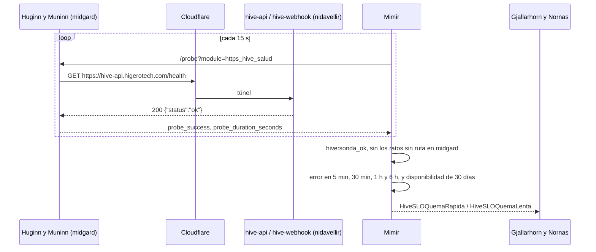

# SLI y SLO de Hive

* **Estado:** review
* **Fecha:** 2026-11-20
* **Decisores:** Jeremi Alcala
* **Fase AI-DLC:** 06-monitoring
* **Versión:** 1.0.0
* **Requisitos:** HIG-140 (Gate 5); reglas en `deploy/prometheus/rules/hive-slo.yml` de Yggdrasil

Qué se promete de Hive, cómo se mide y qué pasa cuando no se cumple.

## Qué se mide y por qué así

**Decisión de Jeremi del 2026-11-20:** los SLI salen de **sondas desde fuera**, y el objetivo de disponibilidad es
el **99,5 % en 30 días**.

- **Hive no expone métricas propias.** Las trazas sí cuentan cada petición, pero en los 7 días anteriores a la
  decisión Saga registró 60: 43 del gateway y 17 del webhook. Con ese tráfico, un SLO por peticiones es ruido: un
  solo error son 2 puntos.
- **La sonda da una muestra cada 15 s** por el mismo camino que los clientes y Meta: Cloudflare, el túnel y
  nidavellir. Mide si Hive se alcanza desde fuera, no si cada ruta funciona. Una ruta rota con `/health` sano no la
  detecta el SLO; la detectan las alertas de [eventos de seguridad](eventos-de-seguridad.md) (`HiveDependenciaFallando`)
  y el vigía.

*Comportamiento, fase 06: de la sonda al aviso.*

## Los SLO

| Componente | SLI | SLO (30 días) | Presupuesto |
|---|---|---|---|
| `hive-api` (gestión, `/oauth/token`) | Sondas a `/health` con 200 y `{"status":"ok"}` | 99,5 % | 3 h 36 min |
| `hive-webhook` (avisos de Meta) | Lo mismo | 99,5 % | 3 h 36 min |
| Los dos | De las sondas buenas, las que responden en menos de 1 s | 99 % | — |

- **La sonda exige el cuerpo de Hive,** no solo el 200: así no cuenta como buena una página que sirva Cloudflare en
  su lugar.
- **Cuando midgard no tiene ruta** (`hogar:ruta_up == 0`), las sondas no miden a Hive, y ese rato no cuenta ni a favor
  ni en contra. De eso ya avisa `HogarSinRuta`.
- **El de latencia es una propuesta** que confirma Jeremi al aprobar este documento.

**De dónde salen los números,** medidos el 2026-11-20 por el mismo camino, con la sonda que ya tenía Zitadel:

| Medida | Valor |
|---|---|
| Disponibilidad, 7 días | 99,87 % |
| Disponibilidad, 30 días (incluye el apagón del 2026-10-30 y la mudanza a nidavellir) | 99,37 % |
| Sondas buenas en menos de 1 s, 30 días | 99,34 % |
| `/health` de Hive desde midgard (15 peticiones por componente) | 0,30 s de mediana, 0,45 s como máximo |

El 99,5 % lo cumple el estado actual; el mes pasado no lo cumplió, por la mudanza y el apagón. Para un solo host
con dos WAN es un objetivo razonable. Mimir guarda 30 días, así que mientras no los tenga, las cifras de 30 días
cuentan lo que haya desde el despliegue de las sondas.

## Alertas del SLO

De ventana doble, como recomienda el capítulo 5 del *SRE workbook*: la ventana larga dice que el gasto es real, y
la corta, que sigue pasando.

| Alerta | Cuándo | Severidad |
|---|---|---|
| `HiveSLOQuemaRapida` | Más del 7,2 % de las sondas fallan en 1 h y en 5 min: a ese ritmo el presupuesto dura dos días. Una caída total avisa en unos 6 min | critical |
| `HiveSLOQuemaLenta` | Más del 3 % en 6 h y en 30 min: un fallo intermitente | warning |
| `HiveSLOPresupuestoAgotado` | La disponibilidad de 30 días baja del 99,5 % | warning |
| `HiveLatenciaFueraDeSLO` | Menos del 99 % de las sondas buenas en menos de 1 s, en 30 días | warning |
| `HiveSLOSinSondas` | Falta alguna de las dos sondas: sin ellas, el SLO parecería perfecto | warning |

Las pruebas de promtool (`deploy/prometheus/tests/hive-slo.test.yml` de Yggdrasil) cubren cada una. Comprueban
también que, sin ruta en midgard, no se gasta presupuesto, y que una caída no cuenta como lentitud. El tablero
«Hive · SLO» de Odín enseña la disponibilidad, el presupuesto que queda, la latencia y las ventanas de la quema.

## Política del presupuesto

- **Con presupuesto,** las releases salen como siempre ([releases](../05-deployment/releases.md)).
- **Agotado** (`HiveSLOPresupuestoAgotado`): solo salen releases que corrigen fiabilidad o seguridad, hasta que
  vuelva a haber presupuesto. Cada caída que lo gastó tiene su postmortem ([runbook](runbook-incidentes.md#5-postmortem)).
- **Un incidente de seguridad no se para por el presupuesto:** contener va antes que la disponibilidad.
- **Un despliegue o un reinicio planificado gasta presupuesto** como cualquier caída: un despliegue tarda unos 95 s
  ([runbook de despliegue](../05-deployment/runbook-despliegue-y-rollback.md)), menos del 1 % del presupuesto.

## Cuándo se revisa

- Llega el primer cliente externo: con tráfico real, se añaden SLI por petición (errores 5xx y latencia de
  `/oauth/token` y del webhook), y se revisa el objetivo con él.
- Tres meses seguidos muy por encima del objetivo: se sube, o se gasta en cambios con más riesgo.
- El objetivo se incumple dos meses seguidos por la infraestructura (host, WAN): se decide entre bajarlo o invertir
  en redundancia.
